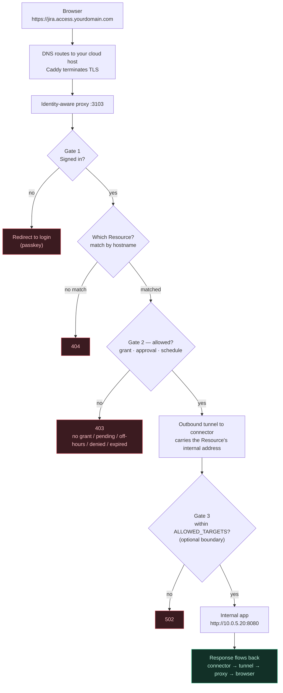
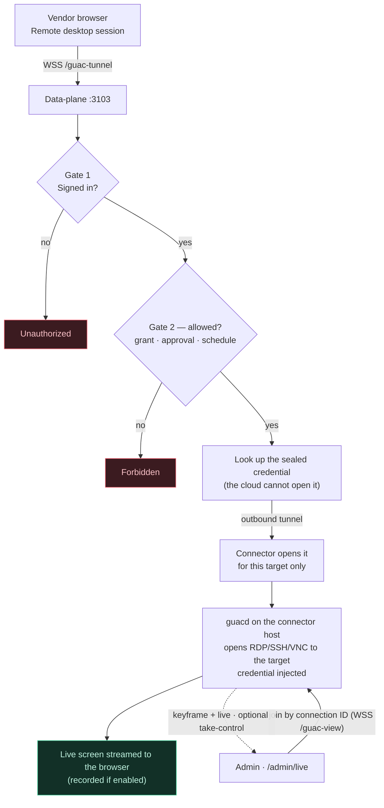
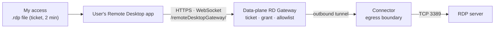
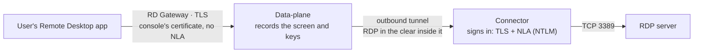
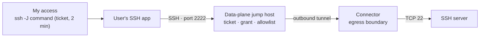
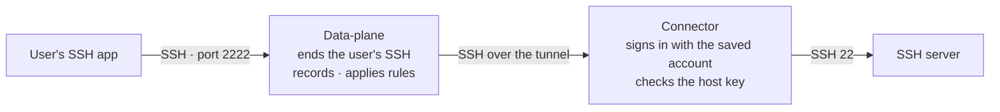
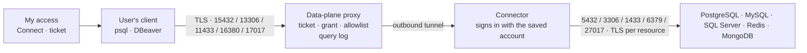
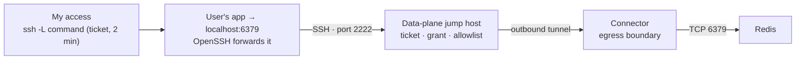
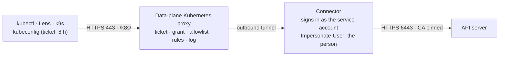
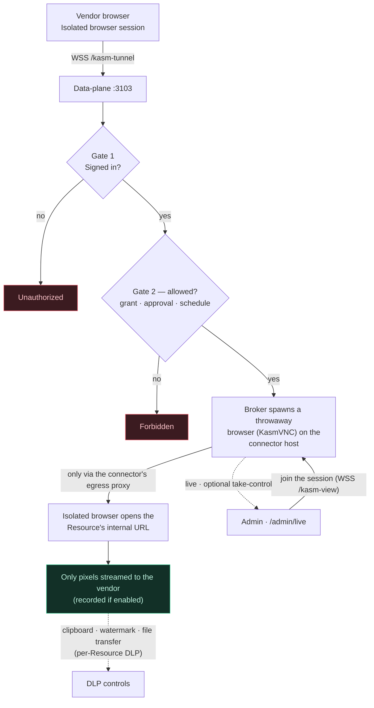

# How Captivo Access works

> **Documentation has moved to captivo.io.** This file stays for readers on GitHub, but [the full Captivo Access documentation](https://captivo.io/en/docs#access) is the one that is kept current, in English and Turkish, for both Cloud and self-hosted installs. Resources, grants, policy, recording and troubleshooting each have their own page there.  
> **Türkçe:** [Captivo Access dokümantasyonunun tamamı](https://captivo.io/dokumanlar#access).

A plain walkthrough: first how the pieces fit together and how you set them up,
then the exact path a single request takes from a vendor's browser to an
internal web app — and every gate it passes through on the way.

Captivo Access gives outside users **time-boxed, audited access to specific
internal web apps and remote desktops (RDP/SSH/VNC)** — without a VPN, without
opening inbound ports, and without ever exposing the apps' real addresses. The
walkthrough below follows a web app; [the remote-desktop path](#the-remote-desktop-path-gateway)
is the same gates with a different tail.

---

## Setup, in plain terms

The whole thing is **two pieces**:

| Piece | Where it runs | What it is |
|---|---|---|
| **Manager** | your cloud (internet-facing) | The front door: identity (passkey/SSO), the admin console, and the access policy. Admins sign in at this address; vendors don't — they reach per-app hostnames served by a companion identity-aware proxy (below). |
| **Connector** | deep inside your network | A small agent that dials **outbound only** — no inbound port is ever opened to it. It's the only thing that reaches your internal apps, and their real addresses never leave your network. It also **stores the session recordings**, encrypted with a key it generates and never sends anywhere. |

Setting it up:

1. **Prepare a server and a subdomain.** A cloud server, and a subdomain
   pointing at it (`access.yourdomain.com`). Set up DNS the safe way — if it's a
   subdomain of a domain you already use for a resource or email, delegate *just*
   that subdomain (see [`deploy/README.md`](../deploy/README.md)); never move the
   parent domain's nameservers.
2. **Install Captivo Access.** One `docker compose … up -d` on the server brings
   up the Manager, its database, and the proxy, with automatic HTTPS. Nothing to
   build — it pulls the published images.
3. **Create the first admin.** Open `manager.access.yourdomain.com/setup` and
   register yourself with a **passkey**. No passwords — your device is the key.
4. **Install a connector inside your network.** In the admin console you create a
   connector and get a ready-to-run `docker run` command. Run it on a machine
   inside your network; it dials out and shows up as online. Later updates (and
   removing it) are a button in the console: a small updater beside the connector
   does the Docker work on the host, and it takes no input from the network
   ([details](install.md#updating-a-connector-from-the-console)).
5. **Define two things: the app, and who.** A **Resource** = which internal app
   (e.g. `jira.access.yourdomain.com` → the app's real internal address, set
   directly on the Resource — the connector itself needs no per-app config; it
   just dials whatever address the Resource sends it, optionally bounded by
   `ALLOWED_TARGETS` on the connector's container).
   An **access grant** = invite the user (they register a passkey) and grant them
   that Resource — optionally time-boxed, approval-gated, or on a recurring schedule
   ("weekdays 09:00–18:00").
6. **Done.** The user signs in from their browser and reaches only the apps
   they're allowed to.

---

## Access reviews

An **access review** (Operate › Access reviews) confirms, every so often, that
everyone who can reach a resource still should; ISO 27001 and SOC 2 audits ask
for the evidence.

- **Opening** lists every live grant in scope (all resources or chosen ones),
  with who granted it and **when it was last used** (the newest allowed access in
  the audit log). Grants unused for 90 days, or never, stand out.
- **Reviewers** are admins and operators; auditors can read. Each grant is kept,
  revoked or limited to an end date, one at a time or many at once. Nobody
  decides on their own access. Decisions can change until the review closes.
- **Closing** (at the due date, 7, 14 or 30 days after opening, or earlier by
  hand) applies the decisions. Grants without a decision are removed or kept, as
  the review was set up; a reviewer's own grant is never removed for silence.
  Revoked grants record who revoked them and in which review.
- **Directory grants** can't be revoked here: the next sign-in would give them
  back while the person is in the group. They are marked "remove from group" and
  listed for the directory administrator.
- **Reminders** go to reviewers by email, mobile push and the bell when a review
  opens, a week before and a day before it is due. A recurring review (every 3,
  6 or 12 months) schedules the next one when it closes; an hourly job opens,
  reminds and closes them.
- **The report** is the closed review: every grant with its decision, who made
  it and when, and its outcome, exportable as CSV and printable. Every decision
  and revocation is also in the admin audit log.

## Ticketing (access tied to a change or incident)

**Ticketing** (Platform › Ticketing) ties access to an ITSM ticket. Each
resource asks for no ticket, a ticket, or accepts an approved ticket as the
approval; the workspace sets the default.

- **The ticket system** is ServiceNow (Table API: changes, incidents and the
  other task tables you tick), Jira Service Management (issue status, service
  desk approvals, optional window fields), an HTTPS endpoint of your own that
  answers `{valid, approved, startsAt, endsAt}`, or "numbers only", which records
  the number without checking it. Calls go from Captivo's cloud, so the system
  must be reachable from the internet.
- **A request or an admin's grant** on a resource that needs a ticket names
  one. It must exist, be in a state the workspace allows, be assigned to the
  person when that is required, and its change window must not be over. The
  access is fitted into the window.
- **"Approved ticket is enough"**: a ticket approved in the ticket system opens
  the access at once; a request on a ticket still waiting for approval opens
  when it is approved there, or when an approver here approves it first.
- **Every 5 minutes** the tickets behind live grants are looked up again. A
  ticket that closed, was cancelled, reassigned or whose window ended ends its
  grants (the live-session recheck cuts open sessions within a minute); a window
  that moved earlier moves the grant's end with it.
- **When the ticket system doesn't answer**, nothing is opened by a ticket and
  nothing is ended. Requests wait for an approver; admins can still grant with
  the ticket marked "not checked", and approving re-checks it first.
- **On the record**: the ticket is on the grant, in the admin audit log, on
  recordings (search Recordings for the number) and in the Grants CSV. Work
  notes on the ticket say who opened and closed a session, on what, for how
  long, with a link to its recordings where sessions are recorded.
- A rule applies to new requests and grants; existing grants keep working until
  they end. Directory grants carry no ticket.

## Connector groups (redundancy and load sharing)

One connector is a single point of failure: when its machine is down, every
resource it serves is unreachable. Install two or more connectors in the same
network, put them in a **connector group** (Connectors → Connector groups), and
choose the group on a resource instead of a single connector.

- **Active and standby members.** New sessions go to the online active member
  carrying the fewest live sessions. A standby member carries sessions only while
  no active member is online.
- **Web apps stay on one member per user.** Every request of a web app is routed
  on its own; each user is kept on the same online member (rendezvous hashing),
  so a recorded page's chunks all reach one connector. When a member leaves, only
  its users move.
- **A connector going down.** Sessions it carried end (an RDP or SSH connection
  cannot move between machines); reconnecting lands on another member. New
  sessions skip it from the moment its tunnel drops.
- **Saved passwords are sealed to each member.** A resource password is sealed in
  the admin's browser to every member's vault key, and each member is handed only
  its own copy.
- **A member that joins later gets its copies from a member that has them.** A
  member on 2.44.0 or later opens each password with its own key and seals it
  again to the newcomer's key, for the same target; the plaintext stays in that
  connector's memory and the cloud stores only the new sealed copy. This runs
  when a group is saved, when a resource is moved onto a group, and on every
  health pass (so a giver that was offline catches up within five minutes). Each
  copy is recorded in the admin audit log and in the giving connector's own log.
  Until a member has its copy, sessions to that resource skip it; if no member
  that holds the password is new enough, the group card asks to update one or to
  enter the password again. The trade-off: a running, compromised control plane
  could ask a connector to seal a password to a key of its choosing. A database
  leak alone cannot, and every such copy leaves a trace on both sides.
- **Members must reach the same machines.** The health check probes a group
  resource through every online member. A member that cannot reach it while
  another can is left out of its sessions, and its card says so.
- **Recordings stay where they were made.** A recording lives on the member that
  carried the session and plays from it; while that member is offline the
  recording cannot be opened.
- Native RDP and native SSH sessions go through members on 2.39.0 or later (recorded native SSH: 2.49.0, recorded native RDP: 2.52.0).
- Revoking or deleting a member moves the group's resources onto another member;
  a group that still serves resources cannot be deleted.
- Not yet covered: the directory (AD/LDAP) connection still uses one connector.

## Password rotation

A remote-desktop, SSH or database resource can have its saved password changed
by the connector, so that nobody, Captivo included, knows the password in use.

- **Who changes it.** A connector that serves the resource (on 2.45.0 or later)
  generates a random 24-character password, changes it on the target and seals
  it to every connector key that serves the resource. The cloud receives and
  stores only sealed values.
- **How.** A Linux account changes its own password with `passwd` over SSH. A
  domain account used for RDP changes its own in Active Directory over LDAPS or
  StartTLS, through the directory configured under Settings › Directory. A
  local Windows account (an RDP user named `Administrator`, `.\name` or
  `COMPUTER\name`; connector 2.63.0) changes its own over SMB (port 445, the
  MS-SAMR password change that Ctrl+Alt+Del uses) and needs no directory; the
  resource's "Whose account" setting overrides what the user name suggests. A
  database account (connector 2.54.0) changes its own: in PostgreSQL with
  `ALTER ROLE CURRENT_USER`, sent as a SCRAM-SHA-256 verifier the connector
  makes, so the password is never in a statement a server could log; in MySQL
  with `ALTER USER CURRENT_USER()` (with `REPLACE` when the server asks for the
  current password), in MariaDB with `SET PASSWORD`, in SQL Server (connector
  2.56.0) with `ALTER LOGIN ... OLD_PASSWORD`, inside the resource's TLS
  (with TLS off the new password crosses the network in the clear, and the
  panel says so). The account should be one only Captivo uses: an application
  that shares it stops connecting at the first rotation. Open database
  connections are not cut. VNC passwords and SSH keys are not rotated.
- **When.** Off by default. Per resource: a minute after the last session on it
  ends (a session still open holds it), on a schedule (7, 30 or 90 days), and
  with "Rotate now". "Check it daily" signs in once a day with the saved
  password and reports a password changed outside Captivo.
- **No lockout.** The new password's seals are stored as *pending* before the
  target is touched, and become the saved password only once the connector has
  seen the target accept them. If the answer is lost, both are kept and the next
  attempt asks the target which one it takes. A failed attempt is retried after
  5 minutes, 15 minutes, an hour, then every 6 hours, and the first failure
  notifies the admins.
- **Reconcile account.** When the account cannot change its own password (Active
  Directory allows one change a day by default; history and policy rules) or
  its saved password no longer matches, a privileged account resets it: root or
  a sudo account on the Linux host (password or SSH key), the built-in
  `Administrator` of a Windows server (or a domain account in its
  Administrators group; remote UAC refuses any other local administrator), a
  directory account with the *Reset password* right (Settings › Directory), or a database account
  on the same server (PostgreSQL: CREATEROLE or a superuser; SQL Server: ALTER
  ANY LOGIN, such as sa; MySQL: CREATE USER,
  which finds the account's host in `mysql.user` and stops if several accounts
  share the name). It is sealed for
  `reconcile,<host>,<port>,<user>`, so the gateway can never sign a session in
  with it, and a connector uses it only against that host. Members of a group
  that come later get a copy the same way as resource passwords.
- **Reveal.** An admin can see the password once, with a reason: the browser
  makes a one-off key pair, the connector seals the password to it, and only
  that page opens it. The reveal and its reason are in the audit log, and the
  password rotates again two hours later.
- **When Captivo cannot be reached.** The connector that rotated a password
  keeps its own sealed copy of it (`/data/rotated.json`, next to its key); the
  resource page names that connector. On its host:
  `docker exec access-connector connector show-password "<resource>"`.
- **Native clients.** A resource that rotates cannot offer an unrecorded native
  RDP or SSH client: the user would need a password nobody knows. Recorded
  native sessions work with rotation, as Captivo signs in with the saved
  password. If recording is later switched off for the resource, its native
  .rdp file and SSH command are refused until it is back on.
- Every rotation, failure, reveal and settings change is in the admin audit log
  and in the connector's history.

---

## Password check-out (take a password for a while)

Some work cannot go through Captivo: a hardware console, a tool that signs in
itself. For those, a resource can let a person **check out** its saved password.

- **Turning it on.** *Password check-out* on a remote desktop, SSH or database
  resource, with the longest check-out (1, 4, 8 or 24 hours). It needs the
  password to be kept in Captivo (not in your own vault) and cannot be combined
  with *Requires a moderator*.
- **Who and how.** Someone with an active grant gets **Check out** on the
  resource in My access, gives a reason (10 characters or more) and receives the
  password once. The connector seals it to a key made in their browser for that
  one look, so it never passes through the console readable. One person at a
  time; a second is told who has it and until when.
- **How long.** The resource's limit, or the end of the person's grant, whichever
  comes first. They can give it back sooner.
- **When it ends** (returned, out of time, the grant revoked or expired, or an
  admin pressing *End now* on the resource's rotation panel) the password is
  changed by rotation within minutes, so what the person holds stops working. A
  password Captivo cannot rotate (VNC, a target without rotation) is left as it
  is and the admins get a notification saying so. While it is out, rotation
  (after a session, scheduled, *Rotate now*) leaves it alone.
- **Audit.** `credential.checkout` and `credential.checkin` in the admin audit
  log, with who, why, until when and whether it is being changed, and a bell
  notification when it is taken. The health cron (every 5 minutes) ends what ran
  out or lost its grant.
- **Requirements:** a connector on 2.45.0 or later (the same one that reveals a
  password to an admin).

## Credentials kept in your own vault (HashiCorp Vault, CyberArk)

A resource's password does not have to live in Captivo. For a remote desktop,
SSH, database or Kubernetes resource, **Where the credential lives** can be
**HashiCorp Vault**, **CyberArk**, **Azure Key Vault** or **AWS Secrets
Manager** instead of **Captivo**.

- **What is saved.** Not a password: a reference (where the secret is) and how
  the connector signs in to the vault. It is sealed in the admin's browser to
  the connector's key, exactly like a password, bound to the resource's host,
  port and user. The console and the data plane never see it.
- **When it is read.** The connector asks the vault each time a session needs the
  credential (a remote-desktop or SSH sign-in, a database or Kubernetes
  connection, a recorded native session) and uses it for that sign-in. Nothing is
  cached or logged, so a password changed in the vault is the one the next
  session uses.
- **HashiCorp Vault.** KV version 2 (or 1): address, optional namespace, mount
  (`secret`), path, field (`password`). The connector signs in with a token or an
  AppRole (role id and secret id, mount `approle`). Give it a policy that reads
  only the paths Captivo needs.
- **CyberArk.** The Central Credential Provider: address, application id, safe,
  object (and folder), plus a client certificate and key when the provider asks
  for one. The connector calls `/AIMWebService/api/Accounts` and uses its
  `Content`.
- **CyberArk's REST API (PVWA).** Besides the Central Credential Provider, the
  connector can sign in to PVWA as a user (CyberArk, LDAP or RADIUS), find the
  account in its safe (or take an account id), retrieve its password with a
  reason that is logged in CyberArk, and sign out. The user needs the Retrieve
  accounts permission; an account that needs dual control or a ticket cannot be
  fetched unattended.
- **Azure Key Vault.** The connector signs in as an app registration (tenant id,
  client id and secret, the Key Vault Secrets User role) and reads the secret,
  at its latest or a given version.
- **AWS Secrets Manager.** The connector signs `GetSecretValue` itself
  (Signature Version 4) with an access key in the reference, or the connector's
  own `AWS_ACCESS_KEY_ID` and `AWS_SECRET_ACCESS_KEY` (and `AWS_SESSION_TOKEN`)
  when the reference has none. A JSON secret gives one field. A VPC endpoint
  can replace the regional one. The instance metadata service (169.254.169.254)
  is not used: the connector refuses link-local addresses.
- **When Captivo keeps the secret** (the default) and the target supports it,
  rotation is available as before; it is off for anything kept in a vault above,
  which has its own rotation (CPM, Key Vault, Secrets Manager rotation).
- **The vault's certificate** is checked against the public CAs, against a CA the
  admin pastes, or not checked (an explicit choice).
- **Where it is allowed.** The vault's address must be reachable from the
  connector and inside its `ALLOWED_TARGETS` when that is set. A group's members
  each get the reference sealed to their own key.
- **Not rotated, not revealed.** The vault owns the credential, so Captivo
  neither rotates it nor shows it; *Reveal* is refused. **Check now** on the
  resource's rotation panel asks the connector to fetch it once and says whether
  the vault answers (audited as `resource.vault_check`); the value is never sent
  back.
- **Requirements:** a connector on 2.66.0 or later (2.67.0 for CyberArk's REST
  API, Azure Key Vault and AWS Secrets Manager). Switching the resource back to
  **Captivo** and entering a password replaces the reference.

## SSH certificates (no password or key anywhere)

An SSH resource can sign in with a certificate instead of a password or a key:
**Where the credential lives** → **SSH certificate**. There is then nothing to
steal, rotate or check out. The connector keeps a certificate authority (CA) key;
the server trusts its public half; every session signs in with a certificate
made for that session.

- **What happens.** A user opens **SSH** on the resource in My access and runs
  the command. The data plane ends their SSH connection (the recorded native
  path), and the connector makes a fresh key pair, signs a certificate for the
  resource's account with its CA key and signs in with it. The certificate is
  valid for two minutes, for that one account, with a terminal and nothing
  else (no agent, X11 or port forwarding). The session goes on after the
  certificate expires; only the sign-in needed it.
- **Who is in the server's log.** The certificate's key id is
  `captivo:<the user's e-mail>`, so sshd's own log says who it was for:
  `Accepted publickey for deploy ... ID captivo:ana@acme.com`. Captivo's audit
  log and the recording have the same session.
- **The CA key never leaves the connector** (`ssh-ca.key` in its data
  directory, next to the vault key). The console only holds the public line,
  which the connector reports and the resource form and the connector's
  Settings tab show.
- **Setting up a server, once.** Put the connector's public line in a file on the
  server, point `TrustedUserCAKeys` at it and reload sshd. The resource form
  shows the commands:

  ```
  echo 'ssh-ed25519 AAAA…' | sudo tee /etc/ssh/captivo_ca.pub
  echo 'TrustedUserCAKeys /etc/ssh/captivo_ca.pub' | sudo tee /etc/ssh/sshd_config.d/captivo-ca.conf
  sudo sshd -t && sudo systemctl reload sshd
  ```

  The account named on the resource must exist on the server. With no
  `AuthorizedPrincipalsFile`, sshd accepts a certificate whose principal equals
  the login name, which is how Captivo signs it. An account can have no password
  at all (set it to `*`); a locked one (`!`) is refused by some sshd builds. If
  sshd has no `Include /etc/ssh/sshd_config.d/*.conf`, add the line to
  `sshd_config` itself.
- **A connector group** signs with each member's own CA, so give the server every
  member's line (one per line in the same file); the resource form lists them
  all.
- **Check now** on the resource's page makes the connector sign a certificate
  and really sign in, then leave: it says whether the server trusts the CA and
  accepts the account.
- **What it needs.** Native SSH client on, session recording on (or required by
  the Policy): a certificate is used by the connector's own sign-in, which only
  the recorded path has. The browser terminal cannot present a certificate, so
  the resource has no **Open** button, only **SSH**. Rotation, check-out and
  *Reveal* do not apply, as there is no password.
- **If the CA is lost** (the connector's data volume), it makes a new one and the
  servers must be told its new public line, like re-entering a sealed password.
- **Requirements:** a connector on 2.69.0 or later (every connector reports its
  CA once updated).

## Administrator rights during a session (Linux)

The account an SSH resource signs in with can stay an ordinary user all day and
have administrator rights only while someone is working on it. On the resource's
page, **Administrator rights during sessions** turns this on.

- **What happens.** When a recorded native SSH session opens, the connector signs
  in as the resource's **administrator account** (root, or one that can use
  sudo), writes `/etc/sudoers.d/captivo-<user>` containing
  `<user> ALL=(ALL:ALL) NOPASSWD: ALL` (checked with `visudo -cf` before it is put
  in place), and then signs in as the account. When the last session on that
  account closes, the entry is removed. Sessions on the same account share the
  entry; it goes with the last. A leftover from a crash is removed by the next
  elevation once it is a day old.
- **What the user sees.** The session's banner says it has administrator rights
  for this session only. The session is recorded as always, so what was done
  with them is on the recording and in the keystroke log.
- **If it cannot be given, the session does not open** (it is not opened without
  the rights the user expected). The reason is in the message: the administrator
  account cannot sign in, sudo needs a password it was not given, `visudo`
  refused the entry.
- **The administrator account** is sealed in the admin's browser to each of the
  resource's connectors, like the reconcile account password rotation uses, and
  is the same account: entering it in either place sets both. A key or a
  password both work; with a password and sudo that asks for one, the password
  is given to sudo.
- **What it needs.** An SSH resource with Native SSH client and session recording
  on (the rights are given to recorded sessions only), an ordinary account
  (lower case letters, digits, `_` and `-`; sudoers.d skips names with a dot, and
  root needs nothing), and a connector on 2.71.0 or later. A Linux server with
  sudo and `/etc/sudoers.d` included (the default). Windows is not covered yet.
- **Not the same as** a check-out or a rotation: no password is shown or
  changed. It combines with certificate sign-in, so an account can have neither
  a password nor a standing sudo.

## Finding and taking over accounts (Linux)

A server has more accounts than anyone wrote down. On an SSH resource that has
an **administrator account** (root, or one that can use sudo; the one entered
under *Administrator rights during sessions*, also used by password rotation),
**Accounts on this server** lists them.

- **What the scan shows.** The connector signs in as the administrator account and
  reads `/etc/passwd`, `/etc/group` and `/etc/shadow`. For each account: its uid and
  shell, whether it can sign in, whether it is an administrator (uid 0, or in
  `sudo`, `wheel` or `admin`), whether its password is locked or empty, and how
  old it is. Only those facts leave the server; a password hash never does. Accounts
  that are already resources are marked. Looking changes nothing and is audited
  (`resource.discovery_scan`).
- **Taking an account over.** Pick up to 20 accounts that can sign in, confirm,
  and Captivo makes each one a resource of its own (same connector or group, same
  server, recording and other session settings as the resource you scanned from,
  named `<resource> · <account>`). The new resource starts with a placeholder
  password that does not work, and rotation runs at once: it finds the saved
  password wrong, resets the account through the administrator account, and keeps
  the new random password sealed to the connector. From then on the account is
  managed like any other: rotation, check-out, grants, recording.
- **What it costs.** The account's password changes. Anything else that signs in
  with the old password (a service, a script, a person) stops working, and the
  page says so before the button is enabled. Take over the account that humans
  use, not one a service depends on, unless the service can be given the new
  password.
- **Never offered:** the administrator account itself (changing its password
  would lock Captivo out), root, accounts without a shell, accounts that are
  already resources. If the source resource's sessions are not recorded, the new
  resources have the native SSH client off, because a native client needs a
  password the user knows.
- **Requirements:** a Linux server with `/etc/shadow` readable by the
  administrator account, and a connector on 2.72.0 or later that holds the
  administrator account. Windows and database accounts are not scanned yet.

## Agents (scripts, pipelines and AI agents)

A machine can ask for access the way a person does, and get it for a few minutes.
**Agents** in the console (Identity & access) makes **agent tokens**.

- **A token is an identity.** Making one creates a user of its own (the vendor role,
  with no way to sign in to the console) and a token. What the agent is given is an
  ordinary access grant for that user, so approval, tickets, schedules, access
  reviews, recording and the audit log all apply as they do for a person. The token
  only says which resources it may ask for (SSH resources and TCP tunnels for now), the
  longest access one request may ask for (5 minutes to 24 hours), how long the token
  lives (up to 90 days), and whether it approves its own requests.
- **The token is shown once**, when it is made; only its hash is kept. Revoking it
  stops it at once and ends the access it holds (the data plane rechecks live
  sessions every minute and closes them). It counts as one user toward the
  workspace's user limit.
- **Asking.** With `Authorization: Bearer <token>` on the workspace's address:
  - `GET /api/agent/v1/me`: the token's limits and the resources it may ask for,
    each with where it stands (`active`, `pending`, `scheduled`, `off_hours`).
  - `POST /api/agent/v1/access` with `{"siteId", "minutes", "reason"}` (a reason of
    at least 10 characters, and optionally `"ticket"` for a resource that takes
    one). The minutes are held to the token's limit. The answer is `pending` (a person
    approves it: they get it by mail and on their phone, with Approve and Deny),
    or `approved` (the ticket was approved in your ticket system, or the token approves
    its own requests; the audit log records `grant.auto_approved`).
  - `GET /api/agent/v1/access/<id>`: `pending`, `active`, `denied`, `revoked`,
    `expired`, and the reason when there is one.
- **Connecting.** `POST /api/agent/v1/connect/<siteId>` once the access is active
  gives an SSH command through the jump host, good for two minutes
  (`ssh -J <ticket>@host:2222 ... user@server`). On a recorded resource Captivo
  signs in as the saved account, so the agent holds no password or key and the
  whole session is recorded; combine it with SSH certificates or sudo only while a
  session is open for no standing credential at all. On an unrecorded resource the
  agent would have to bring the account's own password, so use recorded ones. A
  TCP tunnel returns the port forward instead of a command.
- **What it does not do (yet).** Agents reach SSH resources and tunnels; databases,
  Kubernetes and remote desktops are for people. There is no per-token rate limit.
  A request is for the resource as a whole, not for part of it.
- **Safe defaults.** A new token waits for a person. Turning on self-approval is a
  decision about that one token: it can be given only the resources and minutes
  you set, and only while it is live.

## Inviting someone into a live session

An admin watching a live session can bring in someone from outside the console
(a vendor's specialist, a colleague from another team) to watch it, or to take
control too. They see that one session and nothing else.

- **Invite.** In the watch window on `/admin/live`, **Invite someone**: an
  e-mail address, *Watch* or *Watch and take control*, and how long (15 minutes,
  an hour, or until the session ends; that last one still stops after 12 hours).
  The link is mailed when the workspace has mail, and shown to copy either way.
  Up to 5 open invites per session. Admins only (configure).
- **Who can be invited into what.** Sessions whose view the data plane itself
  gates: browser RDP, SSH and VNC, and recorded native SSH and RDP. Not an
  isolated browser (its view-only is a setting of the viewer's own page, fine for
  an admin, not for an outsider), a web app, a database session or an unrecorded
  native one.
- **Joining.** The link opens a page that says who invited them, into whose
  session, for how long. They sign in with **Captivo ID** under the invited
  address; anyone can make an account there. A workspace with its own sign-in
  provider still uses Captivo ID for guests (its provider knows nobody from
  outside); only a self-hosted console, which never talks to Captivo ID, uses its
  own provider. Policy can require a second factor for guests. The sign-in is
  always fresh (`prompt=login`), and an account under another address is refused.
- **The pass.** Signing in spends the link (once) and gives that browser a
  host-only, HTTP-only `ca_guest` cookie. It is not a console sign-in: no console
  page or API takes it. The data plane asks the manager about it
  (`/api/internal/gateway/guest-authz`) for each view it opens, and only for the
  session and site the invite names. Only SHA-256 hashes of the link and the pass
  are stored (`SessionInvite`).
- **Control.** One holder at a time, as before. A guest takes control only when
  the invite allows it; an admin's **Take control** takes it back from a guest at
  any time (never from another admin), and what the guest held down is let go.
- **Ending.** Withdrawing the invite (or **Remove** once they joined), its time
  running out, or the session ending closes the guest's view at once.
- **What the user is told.** The guest is named: "Ayşe Yılmaz (guest) is watching"
  on the session page, a line in a native SSH terminal (each time, unlike the
  once-a-minute admin notice), and the same when a guest takes control. A native
  RDP app has nowhere to show it, as for admins.
- **The record.** Invite, join (with the Captivo account and address), take and
  give back control, and removal are in the admin audit log, the guest under
  `guest:<invite id>`. A recording lists its invited guests under Details, with
  when they joined and what they could do. The live activity feed names them.
- **Policy.** *Session invitations* (on by default) and *Two-step verification
  for invited guests* (off by default), under Session controls.

## The journey of a single request

**Scenario:** a vendor types `jira.access.yourdomain.com` into their browser.
Every request travels this path. A solid arrow is the path continuing; a
branch labelled **no** is a rule that stops the request.



Step by step:

1. **The browser opens the address.** `jira.access.yourdomain.com` is a public
   *front-door* name you invented — not the real Jira address.
2. **DNS + TLS.** DNS sends that name to your cloud host, where **Caddy**
   terminates HTTPS. The real internal addresses never touch public DNS.
3. **The proxy receives it.** All `*.access.yourdomain.com` traffic lands on one
   identity-aware proxy. From here, three gates.
4. **Gate 1 — Signed in?** The proxy looks for a valid session cookie (has the
   user signed in with their passkey?). **If not → redirect to login**; after the
   passkey ceremony the user returns to where they were.
5. **Which Resource?** The proxy matches the request's hostname to a defined **Resource**.
   **No matching Resource → 404.** An address you never defined leads nowhere.
6. **Gate 2 — Allowed?** The real decision (`evaluateAccess`): does this user have
   a **grant** for this Resource — is it **approved**, and within its **time window**
   and **recurring schedule**? **If not → 403**, with a specific reason: no grant,
   pending approval, outside hours, denied, or expired.
7. **Outbound tunnel.** The proxy sends the request, along with the Resource's
   internal address, through the connector's **outbound-only** tunnel. The
   cloud never dials into your network — the connector always opened the
   connection.
8. **Gate 3 — Within the boundary?** The connector dials the internal address
   defined on the Resource (`http://10.0.5.20:8080`). If the connector's container
   has an optional `ALLOWED_TARGETS` boundary set, the address must fall
   inside it. **Outside it → 502.** Left unset, the connector dials whatever
   address the Manager routes to it.
9. **The internal app responds.** Jira (or whatever it is) sees the request and
   produces its response, as if the user were on the internal network.
10. **The response flows back** — connector → tunnel → proxy → Caddy → browser.
    The user sees Jira. They never "entered" the network; they only spoke to the
    one app they're allowed to, from behind the gates.

> **And all of it is recorded.** Every allow and every deny on this path is
> written to an append-only, hash-chained audit log — who, when, which app, which
> decision. That tamper-evident trail is what backs the compliance story
> (KVKK / Law No. 5651).

> **A few variations on the same path.** WebSocket apps (e.g. a browser-based
> console) are relayed the same way; **web sessions can be recorded** per Resource
> (AES-256-GCM at rest **on the connector's own disk**, never in the control plane) and replayed in the console; internal staff/admins can optionally sign in via
> **SSO/OIDC** instead of a passkey; and **RDP/SSH/VNC** sessions take
> [the remote-desktop path](#the-remote-desktop-path-gateway) below. Who can do
> what in the console is governed by five roles (`ADMIN`, `OPERATOR`, `AUDITOR`,
> `STAFF`, `VENDOR`).

> **Extra policy gates (optional).** Gate 2 can carry more than the grant: a
> **source-IP allowlist** rejects access from networks you didn't approve, a
> **maximum grant duration** stops anyone handing out never-expiring access, and
> **session limits** (idle / max-lifetime / concurrency) bound the login itself,
> and **require two-step verification** refuses any console sign-in whose
> identity provider did not confirm a second factor (or whose passkey did not
> verify the person). All of these live on the console's **Policy** page and
> apply live.

---

## The remote-desktop path (gateway)

A **Remote desktop** Resource (RDP/SSH/VNC) passes the same first two gates, but its
tail is different: instead of an HTTP round trip to an internal app, the browser
runs a live session rendered by **guacd** — the remote-desktop engine every
connector deploys on its own host, alongside the connector itself. The
target's password or key is **sealed to the connector** in the admin's browser:
the vault stores only that sealed form, and only the connector can open it,
per session, to hand to guacd. Neither the vendor nor the hosted service sees
it, and the "internal app" is a live screen streamed to the browser.



- **Gateway-capable by default.** Every connector deploys the session engines
  out of the box — its one install command brings up guacd (RDP/SSH/VNC) and
  KasmVNC (isolated browser) alongside the connector (no separate pack, no
  toggle). guacd shares the `captivo-gateway` network with the connector; the
  isolated browser sits alone on `captivo-isolated`, which has no route out.
- **Checked for as long as it lasts.** A remote-desktop or isolated session is
  one long connection, so the data-plane re-checks it every minute: the sign-in
  (expired, ended, idle), the user, the grant (expiry, schedule window,
  revocation) and the vendor IP allowlist, the same checks a web app gets on
  every request. When access no longer holds the session is closed, the reason
  is written to the audit log, and the vendor's page says why. A web app's own
  long-lived WebSockets are re-checked the same way. If the control plane cannot
  be reached, nothing is cut.
- **Credential injection.** Each connector generates a vault key pair on its own
  disk (`/data/vault.key`) and reports only the public half. When an admin
  enters an RDP/SSH/VNC password or key, the browser seals it to that key before
  sending it, bound to the target's host, port and username. The vault stores
  the sealed form; the data-plane hands guacd a placeholder, and the connector
  replaces it with the opened secret in the handshake — only if the handshake
  goes to the host, port and username the secret was entered for. The username
  and target are stored in clear (they are shown on the resource). Secrets
  entered before a connector reported its key are sealed automatically when it
  does.
- **If the connector's data is lost.** A new `/data` volume means a new vault
  key: the stored secrets can no longer be opened by anyone, and each affected
  resource asks for its password again. Back up the keys (see
  [backing up a connector](install.md#backing-up-a-connector)) if re-entering them
  would be a burden.
- **Recording.** With **Record sessions** on, the guacd stream is captured and
  replayable at `/admin/recordings`. The bytes are written to the **connector's own
  disk**, AES-256-GCM-encrypted with a key only that connector holds; replay and
  command search reach into it on demand, so the control plane never receives the
  content (see [where recordings are stored](install.md#where-session-recordings-are-stored)).
  Once the session has ended the connector turns an RDP/VNC recording into a seekable
  video, a fraction of the size; SSH stays a compressed screen stream.
- **Live view.** An admin or auditor can watch an in-progress session at
  `/admin/live`: the viewer **joins the same guacd connection by its ID**, so
  guacd sends the current screen immediately (not just future changes), and an
  admin can **take control**. The vendor sees a "being monitored" notice, and
  every watch / take / release is audited.
- **The SSH terminal** tells the server it is an `xterm-256color` (connector
  2.58.0; guacd's own default is `linux`): 256 colours, and vim, less or top
  leave the shell's screen as it was when they end. Keys that are not text go as
  xterm sends them, Ctrl/Alt/Shift with arrows and the like included (Ctrl+Left
  jumps a word). Typing into such a full-screen program is not a shell command,
  so it stays out of the keystroke log, as in native SSH. A resource (or the
  Policy) can set **Terminal type** to `linux` for an old system that has no
  xterm entry and says "unknown terminal type".
- **Health + logs.** Gateway targets are TCP-reachability-checked like web apps
  (Resources page + dashboard), and guacd's own logs surface on the connector's
  detail page ("Gateway logs") for troubleshooting.

### Native RDP clients (RD Gateway)

An RDP Resource can also allow **Native RDP client**: the user downloads an
`.rdp` file from **My access** and connects with their own Remote Desktop app
(Windows `mstsc`, the Windows App on macOS, FreeRDP 3). The file points the
client at Captivo's **RD Gateway** (`/remoteDesktopGateway/` on the workspace's
own host) with a signed ticket as the gateway access token. The client speaks
the Terminal Services Gateway protocol over HTTPS (WebSocket transport); the
data-plane checks the ticket, the grant and the IP allowlist, and carries the
RDP bytes through the connector's outbound tunnel to the server. Nothing opens
inbound on the customer's network.



On a resource that is **not recorded**, what this trades away, and why the
option is off by default:

- **The RDP stream is end-to-end** (TLS and CredSSP/NLA between the app and the
  server). Captivo sees no screen and no keys: these sessions are not recorded,
  keystrokes are not logged, and an admin can't watch or take control.
- **The user signs in to the server themselves** with their own account; the
  vault credential is used only by browser sessions and never leaves for a native one.

On a **recorded** resource (connector 2.52.0 or later) the session is recorded
like one in the browser, and the user types no password:



- **The data plane ends the app's TLS** inside the gateway tunnel. The .rdp file
  names the console as the computer (its certificate is the one the data plane
  shows, `DB_TLS_CERT`/`DB_TLS_KEY`; without them a self-signed one, which the
  app asks about once) and asks for no credentials: the app does no NLA with
  Captivo. FreeRDP asks for a user name anyway; anything typed is ignored.
- **The connector signs in** with the saved account: TLS and NLA (CredSSP with
  NTLMv2; a domain that has turned NTLM off entirely can't be reached this way),
  or TLS alone where the server takes it. The password opens only on the
  connector, sealed for that server, and goes into the session's logon info as
  well, so the server logs the user on at once. It is never in the recording.
- **Full quality.** The app negotiates the graphics pipeline (H.264 included)
  with the server as it would directly; Captivo changes only what each side's
  negotiation must agree on, and offers no UDP transport.
- **The recording** is what the server sent, PDU by PDU, kept on the connector
  like any recording. When the session ends the connector replays it into a
  headless FreeRDP client (rdpenc) and keeps a VP9 video, which Recordings
  plays; the PDU stream is removed once the console has the video. The server
  numbers the app's channels in the order the app asked for them, so the
  recording keeps that list (names and options, nothing else the app sent) and
  the replay asks for the same; that is what makes recordings from the macOS,
  iOS and Windows apps play, whose lists differ. The replay runs only what draws
  the screen (the graphics pipeline): what the server sent on sound, clipboard
  and drive channels answered the real app, and is dropped. The connector takes
  "server may compress channel data" out of the app's capabilities (Windows'
  and Apple's apps offer it; FreeRDP can't decompress channel data), so the
  server sends channel data as it is, which the app reads the same way. The
  replay keeps the graphics pipeline's cache at its largest (25,600 slots):
  the server fills what the app offered, and Windows' app offers that one. The pointer is
  drawn in: the server sends its shape, and the recording keeps where the app
  moved it (the position only, no other input). Typed text is logged as the
  resource's keystroke setting says, for the US and Turkish Q keyboard layouts
  (the app names its layout; for another one the log says it isn't supported
  instead of guessing; an app that names none, as the macOS and iOS apps do, is
  read as US and the log says so).
- **The clipboard and drives** follow the resource's rules on the server's side
  too: a channel the rules keep off is not opened at all, whatever the app asks.
- **Watching live.** Sessions shows these sessions with **Watch live**, in the
  same viewer as a browser session, watching only. The connector decodes each
  session as it runs (the picture is the sum of everything the server sent, so
  it can't start when a viewer comes), and while someone watches sends what
  changed, at most ten times a second. An ordinary desktop costs it 1-2% of a
  core; a full-HD video playing, most of one; about 180 MB of memory either way.
  At most `RDP_LIVE_MAX` sessions (default 4; 0 turns live watching off) are
  decoded at once on a connector; later ones are recorded but can't be watched,
  and a decoder that falls behind ends watching, never the session. The user
  isn't told inside their Remote Desktop app (Captivo has nowhere there to write),
  and messages can't reach it: the portal and the .rdp file say sessions may be
  watched live or taken over.
- **Taking control.** An admin watching live can **Take control** (configure
  rights, one admin at a time). The user's input stops reaching the server and
  the admin's goes instead, written by the data plane between the app's own
  PDUs: text as Unicode, so it types the same whatever the server's keyboard
  layout; shortcuts and keys that aren't text (Ctrl+C, arrows, F-keys, the
  Ctrl+Alt+Del button) as keys at their US positions; the mouse and its wheel.
  (Windows takes Unicode input as it is; an xrdp server types only what its
  own keyboard map knows, so letters outside ASCII may not arrive there.)
  Keys and buttons held when control changes hands are released, and the user's
  lock keys are put back. Leaving the view gives control back. The admin's
  typing is in the keystroke log marked as theirs, and their pointer in the
  video; the clipboard and drives are not part of it. No connector update is
  needed.
- **What stays the same:** the grant, its schedule and expiry, the user's status
  and the vendor IP allowlist are checked when the tunnel opens and every minute
  after; the session is listed on the Sessions page (as `RDP · NATIVE`), an admin
  can end it, and its start, end and refusals are in the audit log.
- **The ticket only starts a session.** It is signed with a key derived from
  `DATAPLANE_SECRET`, names the user, the resource and the workspace, and expires
  two minutes after the download; each click makes a new one.
- **Clipboard, drives and printers** follow the resource's rules, sent to the app
  as gateway redirection flags and written into the file. A one-way rule (paste
  only, upload only) turns the whole channel off, ports and plug-and-play devices
  are always off, and these are applied by the app, so they hold for standard
  clients, not against a modified one.
- **Requirements:** a connector on 2.39.0 or later (older ones don't relay the
  stream; 2.52.0 for a recorded resource, with an older one it stays unrecorded,
  or, when the Policy requires recording, unavailable), and, if the connector's
  `ALLOWED_TARGETS` is set, the RDP server's `host:3389` in it. Clients that can't use an RD Gateway with an access token
  (MobaXterm, for example) can't connect this way; the browser session still works.

### Native SSH clients (jump host)

An SSH Resource can also allow **Native SSH client**: under **My access** the
user presses **SSH** and gets a ready command for their own SSH app (OpenSSH in
a terminal or PowerShell, VS Code Remote-SSH, Termius):

```
ssh -J k7f3q9wz2m4x@acme.cloud.captivo.io:2222 deploy@10.0.0.5
```

The `-J` hop is Captivo's **SSH jump host**, run by the data-plane on port
2222. Its user name is a ticket: who, which resource, valid for two minutes to
start connections (more than one, for `scp` or a second terminal). There is no
password or key on that hop, and no shell: the jump host only opens the
`direct-tcpip` channel the client asks for, to that one resource's server,
through its connector. Nothing opens inbound on the customer's network.



On a resource that is **not recorded** it trades away the same things as
native RDP, and is off by default for the same reason:

- **The SSH session is end-to-end** between the app and the server. Captivo sees
  no terminal: these sessions are not recorded, keystrokes are not logged, and
  an admin can't watch.
- **The user signs in to the server themselves** with their own password or key.
- **Port forwarding inside the session** (`-L`, `-D`) is between the app and the
  server and follows the server's `sshd_config` (`AllowTcpForwarding`). The jump
  host itself refuses everything but the one channel, remote forwarding included.

On a **recorded** resource (its own setting, or a Policy that requires
recording) the session is recorded, from connector 2.49.0 on:



- **The data-plane ends the user's SSH connection** (with the jump host's key, so
  the command adds `-o HostKeyAlias=captivo-recorded.<host>` and the client files
  that key under Captivo's name, never the server's). The banner says the
  session is recorded.
- **The connector signs in** to the server with the resource's saved password or
  key, which opens only there, whatever user name the command gave. The user
  needs no password.
- **The server's host key** is kept on first contact, shared with password
  rotation. A different key is refused with a clear message until an admin
  presses **Forget** beside it on the resource.
- **The terminal is recorded** as what it showed (asciicast, on the connector,
  encrypted like every recording) and plays in Recordings with the same controls;
  a password typed at a prompt that doesn't echo is never in it. Typed lines are
  logged when the resource logs keystrokes, masked at password prompts; keys typed
  into a full-screen program (vim, top, less) are left out. A command
  run without a terminal (`ssh host cmd`) is recorded with its output; binary
  output is marked and left out.
- **File transfer follows the resource's file transfer setting**: SFTP is read
  packet by packet, so downloads, uploads and changes (remove, rename, mkdir) are
  allowed or refused one by one, and every transfer is in the audit log with its
  path and size; legacy `scp` and `rsync` are allowed or refused as a whole.
- **Refused:** port forwarding (`-L`, `-R`, `-D`), agent and X11 forwarding, since
  they can't be recorded. VS Code Remote-SSH needs port forwarding, so it works
  only on resources that aren't recorded.
- **Watching live:** on Sessions (`SSH · NATIVE`, "recorded") an admin can watch
  the terminal as the user sees it, send a message or end the session. The jump
  host streams the same output it records; an admin who joins late sees the
  screen as it is now (rebuilt from the output since it was last cleared, with a
  full-screen program such as vim drawn on top). An admin with configure rights
  can **Take control** and type into the terminal on screen; the user's typing is
  dropped meanwhile (not kept for later), and leaving the view gives control
  back. The admin's commands are in the keystroke log marked as theirs. The user
  gets a line in their terminal saying an admin is watching (once a minute at
  most), when control is taken and when it comes back, and an admin's message
  arrives the same way; while a full-screen program
  runs, both wait until it ends so they don't break its screen. Each line is
  marked in the recording. Several terminals over one connection show as tabs.
  This needs no connector update. With a connector older than 2.49.0 a recorded
  resource falls back to the unrecorded way, or, when the Policy requires
  recording, refuses native SSH until the connector is updated.

**For both:**

- The grant, schedule, user status and vendor IP allowlist are checked when the
  channel opens and every minute after; the session is listed on the Sessions
  page, an admin can end it, and its start, end and refusals are in the audit log
  with the client's SSH version.
- **The jump host's key** is kept in the data-plane's `/data` volume, so clients
  trust it once. The portal shows its SHA-256 fingerprint beside the command.
- **Requirements:** a connector on 2.39.0 or later (2.49.0 for recorded), the SSH
  server's `host:port` in the connector's `ALLOWED_TARGETS` if that is set, and
  port 2222 reachable on the console's host. Self-hosted installs publish it from
  the data-plane (`SSH_PUBLIC_PORT` changes the published port, `SSH_PUBLIC_HOST`
  the name in the command, `SSH_ADDR=off` turns the jump host off).

## Database resources (your own client, every query logged)

A **Database** Resource is a PostgreSQL, MySQL (and MariaDB), SQL Server, Redis
or MongoDB server that users reach with their own client (psql, mysql, sqlcmd,
SSMS, Azure Data Studio, redis-cli, RedisInsight, mongosh, Compass, DBeaver,
DataGrip, pgAdmin, MySQL Workbench) through the data plane's **database
proxy**: port 15432 for PostgreSQL, 13306 for MySQL, 11433 for SQL Server,
16380 for Redis, 17017 for MongoDB (each engine opens its own way, so they can't
share a port). **Connect** on the resource in My access gives the connection
details; the user name is a **ticket**:

```
psql "host=<console host> port=15432 user=<ticket> dbname=<database> sslmode=require"
mysql -h <console host> -P 13306 -u <ticket> --ssl-mode=REQUIRED <database>
sqlcmd -S tcp:<console host>,11433 -U <ticket> -P x -d <database>
redis-cli --tls -h <console host> -p 16380 --user <ticket> --pass x
mongosh "mongodb://<ticket>:x@<console host>:17017/?tls=true&authMechanism=PLAIN&authSource=%24external"
```



- **The password never leaves the connector.** The saved account's password is
  sealed to the connectors that serve the resource, like a remote desktop's. The
  connector signs in (PostgreSQL: SCRAM-SHA-256, md5 or password; MySQL:
  caching_sha2_password, mysql_native_password, sha256_password, or a cleartext
  password over TLS, as the server asks; SQL Server: a SQL Server login; Redis:
  `AUTH` and `SELECT`; MongoDB: SCRAM-SHA-256, or SCRAM-SHA-1 on a server that
  only has it) and
  hands the proxy a connection already past authentication. The user never needs
  or sees it; if a client asks for one, it is left empty (SQL Server, Redis and
  MongoDB clients want one: anything will do).
- **The ticket** starts connections for up to eight hours, never past the grant's
  end or the browser sign-in that asked for it: signing out ends it. It is stored
  hashed. A client's connections from one ticket and address are one session in
  the console, so tools that open several (and reconnect after idling) don't
  flood the Sessions page.
- **The query log.** With the resource's **Query log** on (the recording toggle,
  on by default for a new database resource), the proxy reads each statement
  and stores it with its time, duration, row count and error, on the connector
  that carried the session, next to keystroke timelines (so recording search
  finds statements by their text). Results and bind parameter values are never
  stored; password literals (`PASSWORD '...'`, MySQL's `IDENTIFIED BY '...'`,
  SQL Server's `PASSWORD = N'...'`) are masked. Values a client writes into the statement text itself (psql, the
  mysql client and most MySQL drivers do) are part of the statement. The recording page
  shows it as a table, with failed statements and ones worth review (DROP,
  TRUNCATE, DELETE or UPDATE without WHERE, GRANT, ALTER ROLE, INTO OUTFILE,
  ALTER LOGIN, xp_cmdshell, OPENROWSET, sp_configure) marked. Admins see
  the statements live on the Sessions page and can end the session.
- **Access holds while it is used:** the grant, schedule, user status and vendor
  IP allowlist are checked at every new connection and every minute; a session
  whose access ends, or whose ticket ends, is closed.
- **What a session can do is what the account can do.** The proxy does not parse
  SQL to block writes (that is easy to get around and gives false comfort); for
  read-only access, save an account with only SELECT rights. A PostgreSQL
  resource can also limit which databases open (a client naming no database
  lands in the default one). MySQL and SQL Server have no such list: a statement
  can name any database the account can open (`crm.orders`, `crm.dbo.orders`),
  so the account's own grants decide.
- **TLS** is required from the client (the proxy refuses plaintext), including
  PostgreSQL 17's direct TLS; the mysql client needs `--ssl-mode=REQUIRED` or its
  default, the MariaDB client `--ssl`. From the connector to the server it is per
  resource: Off, Encrypted, or Encrypted + verified against the server's CA. MySQL
  5.7 builds on OpenSSL 1.0 offer only DHE key exchange, which the connector does
  not use: turn on ECDHE ciphers there, or set TLS to Off inside the network.
- **Cancel** (Ctrl+C in psql or mysql, Cancel in DBeaver) reaches the server. For
  PostgreSQL the proxy gives the client its own cancel key and forwards a cancel
  to the right server. A MySQL client is given a connection id of the proxy's;
  its `KILL QUERY <id>` from another connection of the same session reaches the
  server with the server's own id.
- **SQL Server specifics.** The proxy answers PRELOGIN requiring encryption
  and ends the client's TLS 1.2 itself (clients set encryption to Mandatory, or
  Optional; Strict, which is TDS 8, is not offered yet). The sign-in is SQL Server
  Authentication with the ticket as the login; Windows (Kerberos/NTLM) and
  Entra ID sign-in are not offered, and MARS is not either. The connector signs
  in with the client's own options (its TDS version, packet size, language,
  application name), so the client gets the server's own answer: its version,
  collation and database. Statements come from SQL batches and from the text
  sp_executesql, sp_prepare and sp_prepexec carry, never their parameter values;
  a prepared statement run again shows as `EXEC sp_execute`. Cancel (Attention)
  reaches the server. From the connector, TLS Off means the login packet only
  is encrypted (SQL Server's own minimum), unless the server forces more.
- **MySQL specifics.** The proxy offers clients only the protocol features every
  MySQL 5.5+ and MariaDB server has (no compression, no `LOAD DATA LOCAL`), so
  any server behind it answers the way the client reads. A client sees the
  version `8.0.36-Captivo-Access` at connect, as the proxy greets it before it
  knows the server; `SELECT VERSION()` gives the real one, and the session's
  feed names it. Changing the user on an open connection (`COM_CHANGE_USER`) is
  refused.
- **Redis specifics.** The proxy takes the ticket from `AUTH`: the user name of
  Redis 6's `AUTH <user> <password>`, or the password of the old one-argument
  form. It speaks RESP2 only: a client that asks for RESP3 (`HELLO 3`) is told
  to fall back, which every common client does. TLS is required on the proxy
  port. Commands are logged by name and first argument (`GET user:1`,
  `HSET cart:7`); values, scripts and everything after the first argument stay
  out, and `FLUSHALL` and `FLUSHDB` are marked for review. A command that signs
  in as someone else, reads or changes the server's configuration, starts
  replication, monitors other clients or changes access rules (`AUTH`, `RESET`,
  `CONFIG`, `DEBUG`, `SHUTDOWN`, `MODULE`, `MIGRATE`, `MONITOR`, `SYNC`,
  `PSYNC`, `REPLICAOF`, `SLAVEOF`, `FAILOVER`, `ACL` except `WHOAMI` and `CAT`,
  `CLIENT REPLY`) is refused by the proxy and never reaches the server
  (`CONFIG GET requirepass` would show the saved password). After
  `SUBSCRIBE` the replies no longer pair with commands, so logging stops for
  that connection (the session's feed says so). The resource's database number
  is selected at sign-in; a client can `SELECT` another one, so the account's
  ACL decides what it reaches. Redis passwords are not rotated yet.
- **MongoDB specifics.** A driver signs in with `authMechanism=PLAIN` and
  `authSource=$external` over TLS: the ticket is the user name. (SCRAM would
  need a password the client knows; a client left on its default sign-in is
  told what to change.) The proxy answers the driver's handshake itself
  (wire version 17, no compression) and the connector signs in to the server
  with the saved account against the resource's authentication database
  (`admin` when empty). Commands are logged by name and `database.collection`
  (`find shop.orders`, `insert shop.orders`) with their duration, the number of
  documents returned or written, and the server's error; filters and documents
  stay out. `drop`, `dropDatabase` and `dropIndexes` are marked for review.
  Signing in again, managing users and roles, `shutdown`, `setParameter`,
  `getCmdLineOpts` and replica set administration are refused by the proxy.
  Compressed messages and the legacy opcodes (except the first `isMaster`) are
  not relayed. MongoDB passwords are not rotated yet.
- **Requirements:** a connector on 2.46.0 or later (2.51.0 for MySQL, 2.56.0
  for SQL Server, 2.64.0 for Redis and MongoDB; it signs in), the database's
  `host:port` in the connector's `ALLOWED_TARGETS` if that is set, and port
  15432 (13306 for MySQL, 11433 for SQL Server, 16380 for Redis, 17017 for
  MongoDB) reachable on the console's host. Self-hosted installs publish them
  from the data-plane (`DB_PUBLIC_PORT` / `MYSQL_PUBLIC_PORT` /
  `MSSQL_PUBLIC_PORT` / `REDIS_PUBLIC_PORT` / `MONGODB_PUBLIC_PORT` change the
  published port, `DB_PUBLIC_HOST` the name in the details, `DB_ADDR=off` /
  `MYSQL_ADDR=off` / `MSSQL_ADDR=off` / `REDIS_ADDR=off` / `MONGO_ADDR=off` turn
  one off). Without `DB_TLS_CERT`/`DB_TLS_KEY` the proxy keeps a self-signed
  certificate in the data-plane's `/data` volume, which `sslmode=require` and
  `--ssl-mode=REQUIRED` accept; SQL Server clients need Trust server
  certificate for it.

### A database user per connection (PostgreSQL, MySQL, MariaDB)

A PostgreSQL or MySQL resource can name a **Session role**. The saved account then
only provisions: it is never used by a person.

- **What happens.** For each connection a user's client opens, the connector signs
  in as the saved account, creates a user named `captivo_tmp_<time>_<random>`
  with a random password that inherits the session role, signs in as it, relays
  the session, and drops it when the connection closes. The client works with
  exactly the session role's rights, and the server's own log and
  `pg_stat_activity` show a user that exists for that connection only. Captivo's
  query log has who it was.
- **Nothing standing.** The password exists only inside the connector for the
  length of the connection. PostgreSQL also stamps the user `VALID UNTIL` ten
  minutes ahead, so a leftover cannot sign in. A user a crash left behind is
  dropped by the next connection that provisions, once it is six hours old.
  Objects the user created in PostgreSQL are reassigned to the session role so
  the user can be dropped.
- **Setting it up, once.** The resource form shows the statements. PostgreSQL: the
  saved account needs `CREATEROLE` and `ADMIN OPTION` on the session role.
  MySQL 8: `CREATE USER` and `ROLE_ADMIN` (plus `SELECT` on `mysql.user` to remove
  leftovers). MariaDB: `CREATE USER`, the role `WITH ADMIN OPTION` and `UPDATE`
  on `mysql.*` (it sets another user's default role that way). The session role
  carries the privileges users get: make it with `CREATE ROLE` and `GRANT`.
- **One user per connection**, so a client that opens a pool makes several. In
  MySQL a `KILL QUERY` from a second connection (Ctrl-C in the `mysql` client)
  cannot reach another user's thread; PostgreSQL's cancel is unaffected.
- **Not combined with** password check-out (there is no shared password to take).
  Rotating the saved account's own password still works.
- **Requirements:** a connector on 2.70.0 or later.

## Connectors without Docker (Windows and Linux services)

The Docker install is the default: it brings guacd and the isolated browser
beside the connector. For a host with no Docker, the connector also ships as a
single program, installed as a Windows service or a systemd unit.

- **Getting it.** **Connectors → Add connector** has **Linux service** and
  **Windows service** tabs next to Docker. The command downloads
  `captivo-connector_<version>_<os>_<arch>` (`.zip` on Windows, `.tar.gz` on
  Linux; amd64, and arm64 for Linux) and `SHA256SUMS` from the GitHub release of
  the console's own version, refuses a download that does not match, and runs
  `connector service install`. The same binary has `connector update` and
  `connector service uninstall [--keep-data]`.
- **What it serves.** Web apps, databases (PostgreSQL, MySQL, SQL Server, Redis,
  MongoDB), Kubernetes clusters and TCP tunnels. It has no remote-desktop,
  SSH-in-the-browser or isolated-browser engine, so the console refuses to put
  those resources on it (`connector_platform`), disables it in the resource
  form, and leaves it out of a group's candidates for them. The connector tells
  the data plane which it is with the `X-Connector-Platform` header
  (`Connector.platform`: `windows`, `linux`, or empty for Docker).
- **Settings.** `connector.conf` (`KEY=VALUE`, the environment the Docker image
  gets as `-e` flags): `/etc/captivo-connector/connector.conf` on Linux,
  `%ProgramData%\Captivo\Connector\connector.conf` on Windows. The first start
  redeems `PAIR_CODE`; after that the token is in the state directory
  (`/var/lib/captivo-connector`, `%ProgramData%\Captivo\Connector\data`),
  next to the recording and vault keys and the recordings. `ALLOWED_TARGETS`,
  `LOG_LEVEL` and the rest work as in Docker.
- **Linux.** A systemd unit that runs as its own user
  (`captivo-connector`), can write only its state directory, and restarts
  whatever stopped it. `journalctl -u captivo-connector -f` is its log. Run the
  install as root; it needs systemd (on a container host, use the Docker image).
- **Windows.** A service (`CaptivoConnector`, automatic, delayed start,
  restarted after a failure) under its own virtual account
  `NT SERVICE\CaptivoConnector`; the data and settings folders are readable only
  by that account, SYSTEM and administrators. Its log is `connector.log` in the
  data folder, rotated at 10 MB. Run the install from an elevated PowerShell.
  This is new: the Windows service has been built and its commands tested as a
  program on Linux, and the install command's download and checksum steps run
  under PowerShell, but the service itself needs its first run on a Windows
  host.
- **Updating.** `connector update` (`sudo captivo-connector update`, or
  `connector.exe update` from an elevated shell) finds the latest release,
  checks its checksum, replaces the program and restarts the service;
  `--version X.Y.Z` picks one, `--check` only says whether a newer one exists.
  There is no updater beside it, so **Update** in the console shows this
  command instead of a button. `CONNECTOR_RELEASE_BASE` points it at a mirror.
- **Recordings.** Command logs (databases, Kubernetes) are kept as usual. There
  is no video encoder on the host, so nothing that needs one is recorded there.

## Moderated sessions (four eyes)

A resource can require a moderator: nobody works on it alone. A session starts
only when a moderator joins it, and the user's keyboard and mouse work only
while that moderator watches.

- **Turning it on.** *Requires a moderator* on a remote desktop or SSH resource
  (`Site.requireModerator`). Policy → *Who can moderate*: admins and operators
  (the default), or admins only. Nobody moderates their own session.
- **Asking.** **Open** shows the user a waiting screen instead of connecting
  (`ModerationRequest`, `/api/gateway/[siteId]/moderation`). The moderators get
  an e-mail (behind the access-request mail switch), a push on the Captivo Admin
  app, the bell and a *Waiting for a moderator* list on `/admin/live` with the
  sidebar badge. A request waits 10 minutes; the user can stop waiting or ask
  again after a decline. When nobody but the user may moderate (no other active
  admin or operator under the Policy roles), no request is made and the user is
  told at once (`no_moderators`); the resource form warns about it while there
  are fewer than two moderators.
- **Admitting.** **Join as moderator** (or **Decline**) answers it. The
  admission starts one session within 2 minutes: the gateway descriptor (or the
  jump host's check) uses it once and tells the data plane who moderates. Until
  then the descriptor refuses the resource with `moderator_required`, so the
  target is never reached without a moderator. The console opens the session to
  watch as soon as it runs.
- **While it runs.** The data plane (`dataplane/moderation.go`) passes the
  user's input only while the moderator has a view of the session open. Without
  one, keys, pointer, clipboard and file transfer are held (protocol liveness
  still passes, so the connection stays), the user's page says so with a
  countdown, and after 2 minutes the session ends (`session_end_policy
  moderator_left`). Another admin or operator can **Moderate** a session whose
  moderator left: the role passes to them (`/api/admin/live/[id]/moderate`). The
  moderator can message the user, take control and end the session, an
  operator too.
- **Which clients.** What a moderator can watch: browser RDP, SSH and VNC, and
  recorded native SSH (the command comes once the session is admitted; one
  connection per admission; the terminal says when the moderator joins or
  leaves). The user's own Remote Desktop app is refused on such a resource for
  now (`moderator_browser_only`), and so is unrecorded native SSH
  (`moderator_needs_recording`).
- **The record.** Admit, decline and take over are in the admin audit log;
  the session's feed shows when the moderator joined and left.

## TCP tunnels (any other service, your own app)

A **TCP tunnel** resource is any TCP service inside the network that has no
path of its own in Captivo: Redis, MongoDB, Oracle, Elasticsearch, a license
server, a vendor's desktop console (a Kubernetes cluster has a type of its own,
below). The admin adds it with
**Add resource → TCP tunnel**, the service's `host:port` and a connector; there
is no saved account. Under **My access** the user presses **Connect** and gets a
command for the SSH client every computer already has (OpenSSH, built into
Windows 10 and later, macOS and Linux):

```
ssh -L 6379:redis.corp:6379 -o ExitOnForwardFailure=yes -p 2222 k7f3q9wz2m4x@acme.cloud.captivo.io
```

While that window is open, the user's own app connects to `localhost:6379` on
their computer. The dialog picks the service's port, or 10000 above it for a
port below 1024 (`10443` for 443), and the user can change it.



- **The same jump host as native SSH.** The ticket starts the tunnel within two
  minutes. Every connection the app makes arrives as a `direct-tcpip` channel and
  goes to the resource's service through its connector (any member of a group),
  whatever host and port the command was edited to name. Remote forwarding and
  everything else is refused.
- **One tunnel is one session.** However many connections the app opens, the SSH
  connection is one entry in **Live sessions**: rechecked every minute against
  the grant, the user and the allowlist, and ended there by an admin. Ending it
  closes every connection, and the window says why. Ctrl+C in the window, or
  closing it, ends the tunnel too.
- **Not recorded.** The bytes are the app's own protocol, often encrypted, so
  there is nothing to replay or watch. The audit log keeps `session_open
  native_tcp` and the close with how long the tunnel was open and how much it
  carried down; the data-plane log adds the connection count and both directions.
  For that reason a workspace whose Policy **requires recording** can't open
  tunnels: the portal shows **Connect** greyed out and the jump host refuses
  the ticket.
- **The app signs in itself.** Captivo injects no credential: what the user can
  do is what the service lets that sign-in do.
- **Connector 2.39.0 or later** (the raw TCP relay native RDP brought); nothing
  new runs on the connector, and its `ALLOWED_TARGETS` applies.
- **Not in this version:** UDP, more than one port per resource, a way past
  networks that block outbound port 2222 (a small `captivo` helper over 443 is
  the next step if customers need one).

Prefer a resource's own type when there is one: a browser session, native SSH
or RDP, a database or a Kubernetes resource records what the tunnel can't.

## Kubernetes (your own kubectl, every request logged)

A **Kubernetes** resource is a cluster's API server, reached with the user's
own `kubectl`, Lens, k9s or Helm. The admin adds it with **Add resource →
Kubernetes**: the API server's `host:port` as `kubectl cluster-info` shows it,
a connector, and a service account's token. **Set up the cluster** in the form
shows the YAML to apply once: a `captivo-access` service account with a
long-lived token Secret, the right to impersonate users and only the groups the
resource names, and a starting role (`edit`, or `view` for a read-only
resource) for the first group. The token and the cluster's CA come out of that
Secret.

Under **My access** the user presses **Connect** and downloads a kubeconfig:

```yaml
clusters:
- name: captivo-prod-cluster
  cluster:
    server: https://acme.cloud.captivo.io/k8s/<resource id>
users:
- name: captivo-prod-cluster
  user:
    token: k7f3q9wz2m4xh8c2r6v5n9pa
```



- **The address is the console's own.** The front proxy sends `/k8s/` to the
  data plane (nginx: buffering off, no body size limit, long timeouts); no new
  port or certificate. The token is a connection ticket like a database
  resource's: up to eight hours, never past the grant's end, ended by signing
  out, stored only hashed. Each **Connect** makes a new one.
- **Captivo signs in, the cluster sees the person.** The data plane drops the
  request's `Authorization` and any `Impersonate-*` header; the connector opens
  the token (sealed to its own key for this API server and account, like a
  database password), checks the API server's certificate against the saved CA
  and sends `Authorization: Bearer <token>` with `Impersonate-User: <the user's
  e-mail>` and `Impersonate-Group` for each group on the resource. The cluster's
  RBAC and its own audit log see the person; bind roles to their address or a
  group to narrow what they may do. `system:` groups can't be named. With
  **Requests act as → The service account**, requests act as the account
  itself (one identity in the cluster's log; Captivo's log still names the
  person).
- **The resource's rules hold before the cluster's.** The data plane reads each
  request's verb, resource and namespace the way the API server does
  (`dataplane/kubereq.go`) and refuses with a `Status` kubectl prints:
  - *Read only*: get, list and watch only; no changes, no `exec`/`attach`, no
    secrets. (`kubectl auth can-i` still answers with the cluster's roles; these
    rules apply on top.)
  - *Namespaces*: only those; a request across all namespaces is refused;
    cluster-wide kinds (nodes, namespaces, CRDs, storage classes) can be read,
    never changed.
  - *Port forwarding* (off unless turned on): `kubectl port-forward` and the API
    server's proxy to pods, services and nodes. What crosses them is not
    recorded; each is logged.
- **Every request is logged.** A ticket's requests from one address are one
  session in **Live sessions** (the feed shows them as they come) and one
  recording: the request log, kept on the connector, with each request's verb,
  resource, namespace, answer and time (`list pods`, `patch deployments.apps/api`,
  refused ones marked). Request bodies and what secrets hold are never stored.
  Discovery requests are only counted. The session ends five minutes after the
  last request finishes; access and the resource's rules are checked again every
  minute (a change applies without reconnecting), and Terminate ends every
  request in flight.
- **kubectl exec and attach are recorded.** The data plane reads the stream
  kubectl chose (WebSocket `v5.channel.k8s.io`, kubectl 1.30 and later, or
  SPDY/3.1 for older clients and libraries) without changing it, and records the
  container's terminal like recorded SSH: each exec is a session of its own,
  watchable live, with typed commands in the keystroke log when the resource logs
  them, the terminal size and the exit code. On a recorded resource an exec over
  a stream it can't read is refused, never relayed unrecorded. `kubectl cp` runs
  as an exec, so its file is in that recording.
- **Connector 2.62.0 or later**, and its `ALLOWED_TARGETS` applies to the API
  server. Managed clusters (EKS, GKE, AKS) work with a service account token
  like any other; their cloud sign-in plugins are not used.
- **Not in this version:** a kubectl in the browser, moderated exec sessions,
  Captivo ID groups as cluster groups, and finding clusters in a cloud account.

## The isolated-browser path (isolated)

An **Isolated browser** Resource passes the same first two gates, but its tail
runs the app inside a **throwaway, server-side browser** (KasmVNC on the connector
host) and streams only pixels to the vendor — the app's content never touches the
vendor's own machine, the strongest isolation of the three methods. It reuses the
gateway plumbing (a `/kasm-tunnel` data-plane relay through the connector) and adds
DLP controls that only make sense when we own the browser: **clipboard** direction
control, an optional **screen watermark** (the vendor's email + a live clock,
composited onto what they see and any screenshot), per-direction **file transfer**
(off by default; upload into the browser and/or download out, each gated per
Resource), a **seekable** video recording (AES-256-GCM at rest), and the same **live watch /
take-control / terminate** as gateway (a second shared client via `/kasm-view`).
The isolated desktop sizes to the vendor's screen so it fills fullscreen.



- **Nothing lands locally.** The app renders inside the server-side browser; the
  vendor only ever receives a pixel stream, so no page content, cookies, or
  downloaded files reach their machine unless **file transfer** is explicitly
  enabled for that Resource.
- **DLP you can only do when you own the browser.** Clipboard direction control,
  a composited screen watermark, and per-direction file transfer are all enforced
  server-side; file transfers are ephemeral (wiped when the session ends) and every
  upload/download is written to the audit log.
- **Recording + live view.** The session records to a **seekable** video, and an
  admin can watch it live at `/admin/live` (joining via `/kasm-view`) and take
  control — the vendor sees a "being monitored" notice, same as gateway.
- **An application, not a network.** The isolated browser has no network of its
  own: its Docker network (`captivo-isolated`) is internal, and its only way out
  is the connector's egress proxy. Each session presents its own token (held by
  the session's extension, unreadable by pages), and the proxy applies that
  Resource's **network access** rule to every request, checking the address it
  actually dials:
  - *This resource and the internet* (default): the Resource's own host — inside
    your network or not — and the public internet (sign-in pages, CDNs), but no
    other internal machine.
  - *Only this resource and the listed hosts*: nothing else, internet included.
  - *Unrestricted*: a deliberate choice.

  Extra hosts (an internal sign-in page, `*.okta.com`) can be listed per
  Resource. The connector host and cloud metadata addresses are never
  reachable, and internal destinations stay inside the connector's own allowed
  targets. Every refused destination is written to the audit log and listed on
  the Resource. Isolated Resources created before this existed only record what
  would be refused until 1 December 2026, or until an admin picks a rule.

A Resource's **access method** — `TRANSPARENT` (web app), `GATEWAY` (remote
desktop), or `ISOLATED` (isolated browser) — is chosen on its form; all three share
the identical session + grant gates above and differ only in the tail.

---

See also: [`deploy/README.md`](../deploy/README.md) for the full production
deploy (DNS, TLS, connector install), and the root
[`README.md`](../README.md) for the architecture overview.
