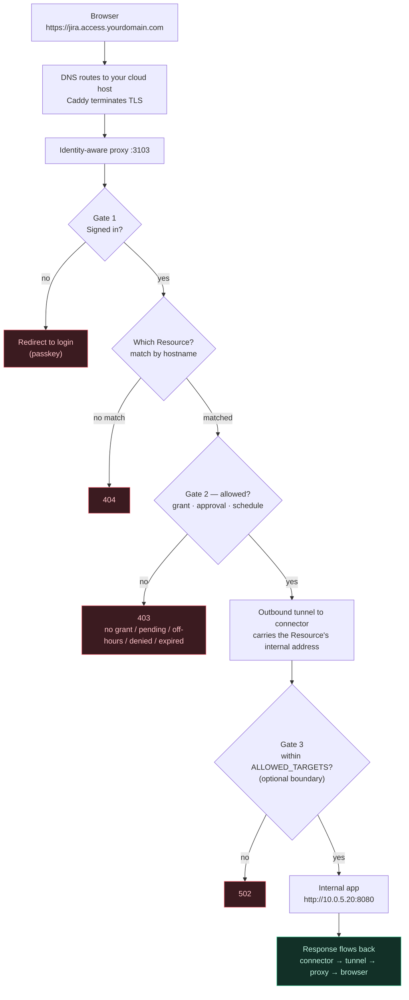
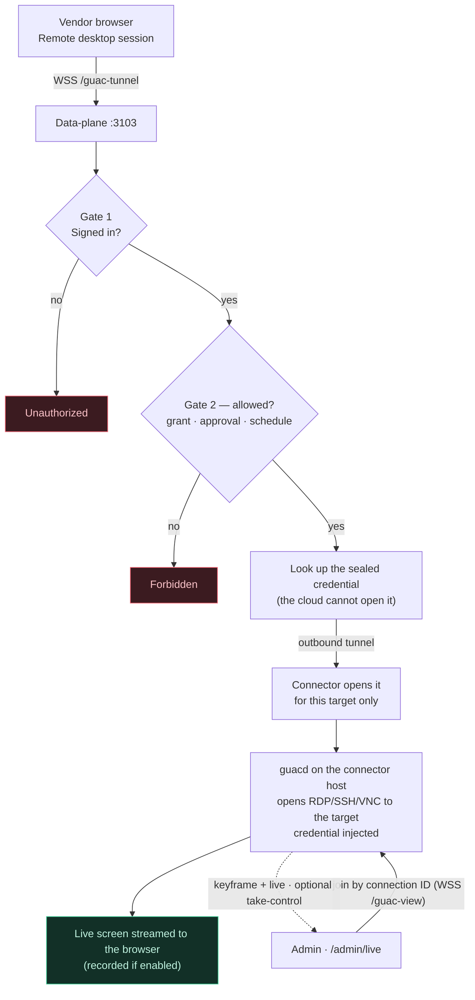
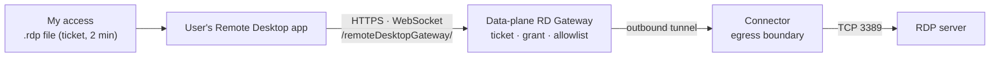
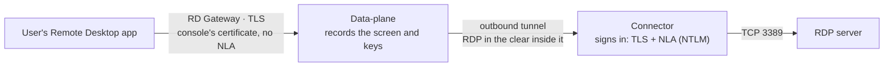
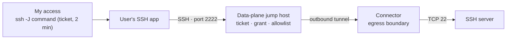
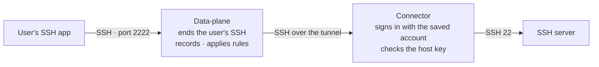
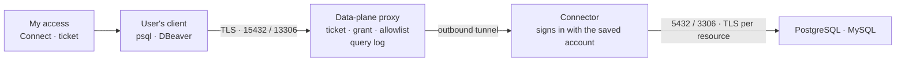
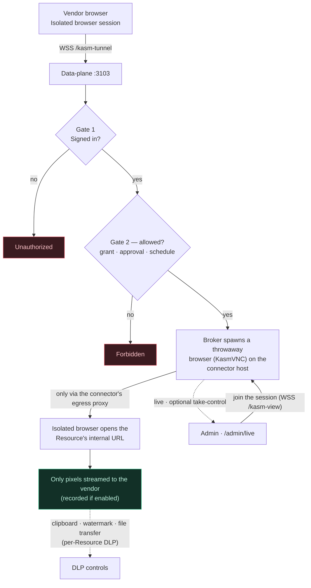

# How Captivo Access works

> **Documentation has moved to captivo.io.** This file stays for readers on GitHub, but [the full Captivo Access documentation](https://captivo.io/en/docs#access) is the one that is kept current, in English and Turkish, for both Cloud and self-hosted installs. Resources, grants, policy, recording and troubleshooting each have their own page there.  
> **Türkçe:** [Captivo Access dokümantasyonunun tamamı](https://captivo.io/dokumanlar#access).

A plain walkthrough: first how the pieces fit together and how you set them up,
then the exact path a single request takes from a vendor's browser to an
internal web app — and every gate it passes through on the way.

Captivo Access gives outside users **time-boxed, audited access to specific
internal web apps and remote desktops (RDP/SSH/VNC)** — without a VPN, without
opening inbound ports, and without ever exposing the apps' real addresses. The
walkthrough below follows a web app; [the remote-desktop path](#the-remote-desktop-path-gateway)
is the same gates with a different tail.

---

## Setup, in plain terms

The whole thing is **two pieces**:

| Piece | Where it runs | What it is |
|---|---|---|
| **Manager** | your cloud (internet-facing) | The front door: identity (passkey/SSO), the admin console, and the access policy. Admins sign in at this address; vendors don't — they reach per-app hostnames served by a companion identity-aware proxy (below). |
| **Connector** | deep inside your network | A small agent that dials **outbound only** — no inbound port is ever opened to it. It's the only thing that reaches your internal apps, and their real addresses never leave your network. It also **stores the session recordings**, encrypted with a key it generates and never sends anywhere. |

Setting it up:

1. **Prepare a server and a subdomain.** A cloud server, and a subdomain
   pointing at it (`access.yourdomain.com`). Set up DNS the safe way — if it's a
   subdomain of a domain you already use for a resource or email, delegate *just*
   that subdomain (see [`deploy/README.md`](../deploy/README.md)); never move the
   parent domain's nameservers.
2. **Install Captivo Access.** One `docker compose … up -d` on the server brings
   up the Manager, its database, and the proxy, with automatic HTTPS. Nothing to
   build — it pulls the published images.
3. **Create the first admin.** Open `manager.access.yourdomain.com/setup` and
   register yourself with a **passkey**. No passwords — your device is the key.
4. **Install a connector inside your network.** In the admin console you create a
   connector and get a ready-to-run `docker run` command. Run it on a machine
   inside your network; it dials out and shows up as online. Later updates (and
   removing it) are a button in the console: a small updater beside the connector
   does the Docker work on the host, and it takes no input from the network
   ([details](install.md#updating-a-connector-from-the-console)).
5. **Define two things: the app, and who.** A **Resource** = which internal app
   (e.g. `jira.access.yourdomain.com` → the app's real internal address, set
   directly on the Resource — the connector itself needs no per-app config; it
   just dials whatever address the Resource sends it, optionally bounded by
   `ALLOWED_TARGETS` on the connector's container).
   An **access grant** = invite the user (they register a passkey) and grant them
   that Resource — optionally time-boxed, approval-gated, or on a recurring schedule
   ("weekdays 09:00–18:00").
6. **Done.** The user signs in from their browser and reaches only the apps
   they're allowed to.

---

## Access reviews

An **access review** (Operate › Access reviews) confirms, every so often, that
everyone who can reach a resource still should; ISO 27001 and SOC 2 audits ask
for the evidence.

- **Opening** lists every live grant in scope (all resources or chosen ones),
  with who granted it and **when it was last used** (the newest allowed access in
  the audit log). Grants unused for 90 days, or never, stand out.
- **Reviewers** are admins and operators; auditors can read. Each grant is kept,
  revoked or limited to an end date, one at a time or many at once. Nobody
  decides on their own access. Decisions can change until the review closes.
- **Closing** (at the due date, 7, 14 or 30 days after opening, or earlier by
  hand) applies the decisions. Grants without a decision are removed or kept, as
  the review was set up; a reviewer's own grant is never removed for silence.
  Revoked grants record who revoked them and in which review.
- **Directory grants** can't be revoked here: the next sign-in would give them
  back while the person is in the group. They are marked "remove from group" and
  listed for the directory administrator.
- **Reminders** go to reviewers by email, mobile push and the bell when a review
  opens, a week before and a day before it is due. A recurring review (every 3,
  6 or 12 months) schedules the next one when it closes; an hourly job opens,
  reminds and closes them.
- **The report** is the closed review: every grant with its decision, who made
  it and when, and its outcome, exportable as CSV and printable. Every decision
  and revocation is also in the admin audit log.

## Ticketing (access tied to a change or incident)

**Ticketing** (Platform › Ticketing) ties access to an ITSM ticket. Each
resource asks for no ticket, a ticket, or accepts an approved ticket as the
approval; the workspace sets the default.

- **The ticket system** is ServiceNow (Table API: changes, incidents and the
  other task tables you tick), Jira Service Management (issue status, service
  desk approvals, optional window fields), an HTTPS endpoint of your own that
  answers `{valid, approved, startsAt, endsAt}`, or "numbers only", which records
  the number without checking it. Calls go from Captivo's cloud, so the system
  must be reachable from the internet.
- **A request or an admin's grant** on a resource that needs a ticket names
  one. It must exist, be in a state the workspace allows, be assigned to the
  person when that is required, and its change window must not be over. The
  access is fitted into the window.
- **"Approved ticket is enough"**: a ticket approved in the ticket system opens
  the access at once; a request on a ticket still waiting for approval opens
  when it is approved there, or when an approver here approves it first.
- **Every 5 minutes** the tickets behind live grants are looked up again. A
  ticket that closed, was cancelled, reassigned or whose window ended ends its
  grants (the live-session recheck cuts open sessions within a minute); a window
  that moved earlier moves the grant's end with it.
- **When the ticket system doesn't answer**, nothing is opened by a ticket and
  nothing is ended. Requests wait for an approver; admins can still grant with
  the ticket marked "not checked", and approving re-checks it first.
- **On the record**: the ticket is on the grant, in the admin audit log, on
  recordings (search Recordings for the number) and in the Grants CSV. Work
  notes on the ticket say who opened and closed a session, on what, for how
  long, with a link to its recordings where sessions are recorded.
- A rule applies to new requests and grants; existing grants keep working until
  they end. Directory grants carry no ticket.

## Connector groups (redundancy and load sharing)

One connector is a single point of failure: when its machine is down, every
resource it serves is unreachable. Install two or more connectors in the same
network, put them in a **connector group** (Connectors → Connector groups), and
choose the group on a resource instead of a single connector.

- **Active and standby members.** New sessions go to the online active member
  carrying the fewest live sessions. A standby member carries sessions only while
  no active member is online.
- **Web apps stay on one member per user.** Every request of a web app is routed
  on its own; each user is kept on the same online member (rendezvous hashing),
  so a recorded page's chunks all reach one connector. When a member leaves, only
  its users move.
- **A connector going down.** Sessions it carried end (an RDP or SSH connection
  cannot move between machines); reconnecting lands on another member. New
  sessions skip it from the moment its tunnel drops.
- **Saved passwords are sealed to each member.** A resource password is sealed in
  the admin's browser to every member's vault key, and each member is handed only
  its own copy.
- **A member that joins later gets its copies from a member that has them.** A
  member on 2.44.0 or later opens each password with its own key and seals it
  again to the newcomer's key, for the same target; the plaintext stays in that
  connector's memory and the cloud stores only the new sealed copy. This runs
  when a group is saved, when a resource is moved onto a group, and on every
  health pass (so a giver that was offline catches up within five minutes). Each
  copy is recorded in the admin audit log and in the giving connector's own log.
  Until a member has its copy, sessions to that resource skip it; if no member
  that holds the password is new enough, the group card asks to update one or to
  enter the password again. The trade-off: a running, compromised control plane
  could ask a connector to seal a password to a key of its choosing. A database
  leak alone cannot, and every such copy leaves a trace on both sides.
- **Members must reach the same machines.** The health check probes a group
  resource through every online member. A member that cannot reach it while
  another can is left out of its sessions, and its card says so.
- **Recordings stay where they were made.** A recording lives on the member that
  carried the session and plays from it; while that member is offline the
  recording cannot be opened.
- Native RDP and native SSH sessions go through members on 2.39.0 or later (recorded native SSH: 2.49.0, recorded native RDP: 2.52.0).
- Revoking or deleting a member moves the group's resources onto another member;
  a group that still serves resources cannot be deleted.
- Not yet covered: the directory (AD/LDAP) connection still uses one connector.

## Password rotation

A remote-desktop, SSH or database resource can have its saved password changed
by the connector, so that nobody, Captivo included, knows the password in use.

- **Who changes it.** A connector that serves the resource (on 2.45.0 or later)
  generates a random 24-character password, changes it on the target and seals
  it to every connector key that serves the resource. The cloud receives and
  stores only sealed values.
- **How.** A Linux account changes its own password with `passwd` over SSH. A
  domain account used for RDP changes its own in Active Directory over LDAPS or
  StartTLS, through the directory configured under Settings › Directory. A
  database account (connector 2.54.0) changes its own: in PostgreSQL with
  `ALTER ROLE CURRENT_USER`, sent as a SCRAM-SHA-256 verifier the connector
  makes, so the password is never in a statement a server could log; in MySQL
  with `ALTER USER CURRENT_USER()` (with `REPLACE` when the server asks for the
  current password), in MariaDB with `SET PASSWORD`, inside the resource's TLS
  (with TLS off the new password crosses the network in the clear, and the
  panel says so). The account should be one only Captivo uses: an application
  that shares it stops connecting at the first rotation. Open database
  connections are not cut. VNC passwords and SSH keys are not rotated, and
  neither are local Windows accounts or SQL Server yet.
- **When.** Off by default. Per resource: a minute after the last session on it
  ends (a session still open holds it), on a schedule (7, 30 or 90 days), and
  with "Rotate now". "Check it daily" signs in once a day with the saved
  password and reports a password changed outside Captivo.
- **No lockout.** The new password's seals are stored as *pending* before the
  target is touched, and become the saved password only once the connector has
  seen the target accept them. If the answer is lost, both are kept and the next
  attempt asks the target which one it takes. A failed attempt is retried after
  5 minutes, 15 minutes, an hour, then every 6 hours, and the first failure
  notifies the admins.
- **Reconcile account.** When the account cannot change its own password (Active
  Directory allows one change a day by default; history and policy rules) or
  its saved password no longer matches, a privileged account resets it: root or
  a sudo account on the Linux host (password or SSH key), a directory account
  with the *Reset password* right (Settings › Directory), or a database account
  on the same server (PostgreSQL: CREATEROLE or a superuser; MySQL: CREATE USER,
  which finds the account's host in `mysql.user` and stops if several accounts
  share the name). It is sealed for
  `reconcile,<host>,<port>,<user>`, so the gateway can never sign a session in
  with it, and a connector uses it only against that host. Members of a group
  that come later get a copy the same way as resource passwords.
- **Reveal.** An admin can see the password once, with a reason: the browser
  makes a one-off key pair, the connector seals the password to it, and only
  that page opens it. The reveal and its reason are in the audit log, and the
  password rotates again two hours later.
- **When Captivo cannot be reached.** The connector that rotated a password
  keeps its own sealed copy of it (`/data/rotated.json`, next to its key); the
  resource page names that connector. On its host:
  `docker exec access-connector connector show-password "<resource>"`.
- **Native clients.** A resource that rotates cannot offer an unrecorded native
  RDP or SSH client: the user would need a password nobody knows. Recorded
  native sessions work with rotation, as Captivo signs in with the saved
  password. If recording is later switched off for the resource, its native
  .rdp file and SSH command are refused until it is back on.
- Every rotation, failure, reveal and settings change is in the admin audit log
  and in the connector's history.

---

## The journey of a single request

**Scenario:** a vendor types `jira.access.yourdomain.com` into their browser.
Every request travels this path. A solid arrow is the path continuing; a
branch labelled **no** is a rule that stops the request.



Step by step:

1. **The browser opens the address.** `jira.access.yourdomain.com` is a public
   *front-door* name you invented — not the real Jira address.
2. **DNS + TLS.** DNS sends that name to your cloud host, where **Caddy**
   terminates HTTPS. The real internal addresses never touch public DNS.
3. **The proxy receives it.** All `*.access.yourdomain.com` traffic lands on one
   identity-aware proxy. From here, three gates.
4. **Gate 1 — Signed in?** The proxy looks for a valid session cookie (has the
   user signed in with their passkey?). **If not → redirect to login**; after the
   passkey ceremony the user returns to where they were.
5. **Which Resource?** The proxy matches the request's hostname to a defined **Resource**.
   **No matching Resource → 404.** An address you never defined leads nowhere.
6. **Gate 2 — Allowed?** The real decision (`evaluateAccess`): does this user have
   a **grant** for this Resource — is it **approved**, and within its **time window**
   and **recurring schedule**? **If not → 403**, with a specific reason: no grant,
   pending approval, outside hours, denied, or expired.
7. **Outbound tunnel.** The proxy sends the request, along with the Resource's
   internal address, through the connector's **outbound-only** tunnel. The
   cloud never dials into your network — the connector always opened the
   connection.
8. **Gate 3 — Within the boundary?** The connector dials the internal address
   defined on the Resource (`http://10.0.5.20:8080`). If the connector's container
   has an optional `ALLOWED_TARGETS` boundary set, the address must fall
   inside it. **Outside it → 502.** Left unset, the connector dials whatever
   address the Manager routes to it.
9. **The internal app responds.** Jira (or whatever it is) sees the request and
   produces its response, as if the user were on the internal network.
10. **The response flows back** — connector → tunnel → proxy → Caddy → browser.
    The user sees Jira. They never "entered" the network; they only spoke to the
    one app they're allowed to, from behind the gates.

> **And all of it is recorded.** Every allow and every deny on this path is
> written to an append-only, hash-chained audit log — who, when, which app, which
> decision. That tamper-evident trail is what backs the compliance story
> (KVKK / Law No. 5651).

> **A few variations on the same path.** WebSocket apps (e.g. a browser-based
> console) are relayed the same way; **web sessions can be recorded** per Resource
> (AES-256-GCM at rest **on the connector's own disk**, never in the control plane) and replayed in the console; internal staff/admins can optionally sign in via
> **SSO/OIDC** instead of a passkey; and **RDP/SSH/VNC** sessions take
> [the remote-desktop path](#the-remote-desktop-path-gateway) below. Who can do
> what in the console is governed by five roles (`ADMIN`, `OPERATOR`, `AUDITOR`,
> `STAFF`, `VENDOR`).

> **Extra policy gates (optional).** Gate 2 can carry more than the grant: a
> **source-IP allowlist** rejects access from networks you didn't approve, a
> **maximum grant duration** stops anyone handing out never-expiring access, and
> **session limits** (idle / max-lifetime / concurrency) bound the login itself,
> and **require two-step verification** refuses any console sign-in whose
> identity provider did not confirm a second factor (or whose passkey did not
> verify the person). All of these live on the console's **Policy** page and
> apply live.

---

## The remote-desktop path (gateway)

A **Remote desktop** Resource (RDP/SSH/VNC) passes the same first two gates, but its
tail is different: instead of an HTTP round trip to an internal app, the browser
runs a live session rendered by **guacd** — the remote-desktop engine every
connector deploys on its own host, alongside the connector itself. The
target's password or key is **sealed to the connector** in the admin's browser:
the vault stores only that sealed form, and only the connector can open it,
per session, to hand to guacd. Neither the vendor nor the hosted service sees
it, and the "internal app" is a live screen streamed to the browser.



- **Gateway-capable by default.** Every connector deploys the session engines
  out of the box — its one install command brings up guacd (RDP/SSH/VNC) and
  KasmVNC (isolated browser) alongside the connector (no separate pack, no
  toggle). guacd shares the `captivo-gateway` network with the connector; the
  isolated browser sits alone on `captivo-isolated`, which has no route out.
- **Checked for as long as it lasts.** A remote-desktop or isolated session is
  one long connection, so the data-plane re-checks it every minute: the sign-in
  (expired, ended, idle), the user, the grant (expiry, schedule window,
  revocation) and the vendor IP allowlist, the same checks a web app gets on
  every request. When access no longer holds the session is closed, the reason
  is written to the audit log, and the vendor's page says why. A web app's own
  long-lived WebSockets are re-checked the same way. If the control plane cannot
  be reached, nothing is cut.
- **Credential injection.** Each connector generates a vault key pair on its own
  disk (`/data/vault.key`) and reports only the public half. When an admin
  enters an RDP/SSH/VNC password or key, the browser seals it to that key before
  sending it, bound to the target's host, port and username. The vault stores
  the sealed form; the data-plane hands guacd a placeholder, and the connector
  replaces it with the opened secret in the handshake — only if the handshake
  goes to the host, port and username the secret was entered for. The username
  and target are stored in clear (they are shown on the resource). Secrets
  entered before a connector reported its key are sealed automatically when it
  does.
- **If the connector's data is lost.** A new `/data` volume means a new vault
  key: the stored secrets can no longer be opened by anyone, and each affected
  resource asks for its password again. Back up the keys (see
  [backing up a connector](install.md#backing-up-a-connector)) if re-entering them
  would be a burden.
- **Recording.** With **Record sessions** on, the guacd stream is captured and
  replayable at `/admin/recordings`. The bytes are written to the **connector's own
  disk**, AES-256-GCM-encrypted with a key only that connector holds; replay and
  command search reach into it on demand, so the control plane never receives the
  content (see [where recordings are stored](install.md#where-session-recordings-are-stored)).
  Once the session has ended the connector turns an RDP/VNC recording into a seekable
  video, a fraction of the size; SSH stays a compressed screen stream.
- **Live view.** An admin or auditor can watch an in-progress session at
  `/admin/live`: the viewer **joins the same guacd connection by its ID**, so
  guacd sends the current screen immediately (not just future changes), and an
  admin can **take control**. The vendor sees a "being monitored" notice, and
  every watch / take / release is audited.
- **Health + logs.** Gateway targets are TCP-reachability-checked like web apps
  (Resources page + dashboard), and guacd's own logs surface on the connector's
  detail page ("Gateway logs") for troubleshooting.

### Native RDP clients (RD Gateway)

An RDP Resource can also allow **Native RDP client**: the user downloads an
`.rdp` file from **My access** and connects with their own Remote Desktop app
(Windows `mstsc`, the Windows App on macOS, FreeRDP 3). The file points the
client at Captivo's **RD Gateway** (`/remoteDesktopGateway/` on the workspace's
own host) with a signed ticket as the gateway access token. The client speaks
the Terminal Services Gateway protocol over HTTPS (WebSocket transport); the
data-plane checks the ticket, the grant and the IP allowlist, and carries the
RDP bytes through the connector's outbound tunnel to the server. Nothing opens
inbound on the customer's network.



On a resource that is **not recorded**, what this trades away, and why the
option is off by default:

- **The RDP stream is end-to-end** (TLS and CredSSP/NLA between the app and the
  server). Captivo sees no screen and no keys: these sessions are not recorded,
  keystrokes are not logged, and an admin can't watch or take control.
- **The user signs in to the server themselves** with their own account; the
  vault credential is used only by browser sessions and never leaves for a native one.

On a **recorded** resource (connector 2.52.0 or later) the session is recorded
like one in the browser, and the user types no password:



- **The data plane ends the app's TLS** inside the gateway tunnel. The .rdp file
  names the console as the computer (its certificate is the one the data plane
  shows, `DB_TLS_CERT`/`DB_TLS_KEY`; without them a self-signed one, which the
  app asks about once) and asks for no credentials: the app does no NLA with
  Captivo. FreeRDP asks for a user name anyway; anything typed is ignored.
- **The connector signs in** with the saved account: TLS and NLA (CredSSP with
  NTLMv2; a domain that has turned NTLM off entirely can't be reached this way),
  or TLS alone where the server takes it. The password opens only on the
  connector, sealed for that server, and goes into the session's logon info as
  well, so the server logs the user on at once. It is never in the recording.
- **Full quality.** The app negotiates the graphics pipeline (H.264 included)
  with the server as it would directly; Captivo changes only what each side's
  negotiation must agree on, and offers no UDP transport.
- **The recording** is what the server sent, PDU by PDU, kept on the connector
  like any recording. When the session ends the connector replays it into a
  headless FreeRDP client (rdpenc) and keeps a VP9 video, which Recordings
  plays; the PDU stream is removed once the console has the video. The server
  numbers the app's channels in the order the app asked for them, so the
  recording keeps that list (names and options, nothing else the app sent) and
  the replay asks for the same; that is what makes recordings from the macOS,
  iOS and Windows apps play, whose lists differ. The replay runs only what draws
  the screen (the graphics pipeline): what the server sent on sound, clipboard
  and drive channels answered the real app, and is dropped. The pointer is
  drawn in: the server sends its shape, and the recording keeps where the app
  moved it (the position only, no other input). Typed text is logged as the
  resource's keystroke setting says, for the US and Turkish Q keyboard layouts
  (the app names its layout; for another one the log says it isn't supported
  instead of guessing; an app that names none, as the macOS and iOS apps do, is
  read as US and the log says so).
- **The clipboard and drives** follow the resource's rules on the server's side
  too: a channel the rules keep off is not opened at all, whatever the app asks.
- **Watching live.** Sessions shows these sessions with **Watch live**, in the
  same viewer as a browser session, watching only. The connector decodes each
  session as it runs (the picture is the sum of everything the server sent, so
  it can't start when a viewer comes), and while someone watches sends what
  changed, at most ten times a second. An ordinary desktop costs it 1-2% of a
  core; a full-HD video playing, most of one; about 180 MB of memory either way.
  At most `RDP_LIVE_MAX` sessions (default 4; 0 turns live watching off) are
  decoded at once on a connector; later ones are recorded but can't be watched,
  and a decoder that falls behind ends watching, never the session. The user
  isn't told inside their Remote Desktop app (Captivo has nowhere there to write),
  and messages can't reach it: the portal and the .rdp file say sessions may be
  watched live.
- **What stays the same:** the grant, its schedule and expiry, the user's status
  and the vendor IP allowlist are checked when the tunnel opens and every minute
  after; the session is listed on the Sessions page (as `RDP · NATIVE`), an admin
  can end it, and its start, end and refusals are in the audit log.
- **The ticket only starts a session.** It is signed with a key derived from
  `DATAPLANE_SECRET`, names the user, the resource and the workspace, and expires
  two minutes after the download; each click makes a new one.
- **Clipboard, drives and printers** follow the resource's rules, sent to the app
  as gateway redirection flags and written into the file. A one-way rule (paste
  only, upload only) turns the whole channel off, ports and plug-and-play devices
  are always off, and these are applied by the app, so they hold for standard
  clients, not against a modified one.
- **Requirements:** a connector on 2.39.0 or later (older ones don't relay the
  stream; 2.52.0 for a recorded resource, with an older one it stays unrecorded,
  or, when the Policy requires recording, unavailable), and, if the connector's
  `ALLOWED_TARGETS` is set, the RDP server's `host:3389` in it. Clients that can't use an RD Gateway with an access token
  (MobaXterm, for example) can't connect this way; the browser session still works.

### Native SSH clients (jump host)

An SSH Resource can also allow **Native SSH client**: under **My access** the
user presses **SSH** and gets a ready command for their own SSH app (OpenSSH in
a terminal or PowerShell, VS Code Remote-SSH, Termius):

```
ssh -J k7f3q9wz2m4x@acme.cloud.captivo.io:2222 deploy@10.0.0.5
```

The `-J` hop is Captivo's **SSH jump host**, run by the data-plane on port
2222. Its user name is a ticket: who, which resource, valid for two minutes to
start connections (more than one, for `scp` or a second terminal). There is no
password or key on that hop, and no shell: the jump host only opens the
`direct-tcpip` channel the client asks for, to that one resource's server,
through its connector. Nothing opens inbound on the customer's network.



On a resource that is **not recorded** it trades away the same things as
native RDP, and is off by default for the same reason:

- **The SSH session is end-to-end** between the app and the server. Captivo sees
  no terminal: these sessions are not recorded, keystrokes are not logged, and
  an admin can't watch.
- **The user signs in to the server themselves** with their own password or key.
- **Port forwarding inside the session** (`-L`, `-D`) is between the app and the
  server and follows the server's `sshd_config` (`AllowTcpForwarding`). The jump
  host itself refuses everything but the one channel, remote forwarding included.

On a **recorded** resource (its own setting, or a Policy that requires
recording) the session is recorded, from connector 2.49.0 on:



- **The data-plane ends the user's SSH connection** (with the jump host's key, so
  the command adds `-o HostKeyAlias=captivo-recorded.<host>` and the client files
  that key under Captivo's name, never the server's). The banner says the
  session is recorded.
- **The connector signs in** to the server with the resource's saved password or
  key, which opens only there, whatever user name the command gave. The user
  needs no password.
- **The server's host key** is kept on first contact, shared with password
  rotation. A different key is refused with a clear message until an admin
  presses **Forget** beside it on the resource.
- **The terminal is recorded** as what it showed (asciicast, on the connector,
  encrypted like every recording) and plays in Recordings with the same controls;
  a password typed at a prompt that doesn't echo is never in it. Typed lines are
  logged when the resource logs keystrokes, masked at password prompts; keys typed
  into a full-screen program (vim, top, less) are left out. A command
  run without a terminal (`ssh host cmd`) is recorded with its output; binary
  output is marked and left out.
- **File transfer follows the resource's file transfer setting**: SFTP is read
  packet by packet, so downloads, uploads and changes (remove, rename, mkdir) are
  allowed or refused one by one, and every transfer is in the audit log with its
  path and size; legacy `scp` and `rsync` are allowed or refused as a whole.
- **Refused:** port forwarding (`-L`, `-R`, `-D`), agent and X11 forwarding, since
  they can't be recorded. VS Code Remote-SSH needs port forwarding, so it works
  only on resources that aren't recorded.
- **Watching live:** on Sessions (`SSH · NATIVE`, "recorded") an admin can watch
  the terminal as the user sees it, send a message or end the session. The jump
  host streams the same output it records; an admin who joins late sees the
  screen as it is now (rebuilt from the output since it was last cleared, with a
  full-screen program such as vim drawn on top). Watching is view only. The user
  gets a line in their terminal saying an admin is watching (once a minute at
  most), and an admin's message arrives the same way; while a full-screen program
  runs, both wait until it ends so they don't break its screen. Each line is
  marked in the recording. Several terminals over one connection show as tabs.
  This needs no connector update. With a connector older than 2.49.0 a recorded
  resource falls back to the unrecorded way, or, when the Policy requires
  recording, refuses native SSH until the connector is updated.

**For both:**

- The grant, schedule, user status and vendor IP allowlist are checked when the
  channel opens and every minute after; the session is listed on the Sessions
  page, an admin can end it, and its start, end and refusals are in the audit log
  with the client's SSH version.
- **The jump host's key** is kept in the data-plane's `/data` volume, so clients
  trust it once. The portal shows its SHA-256 fingerprint beside the command.
- **Requirements:** a connector on 2.39.0 or later (2.49.0 for recorded), the SSH
  server's `host:port` in the connector's `ALLOWED_TARGETS` if that is set, and
  port 2222 reachable on the console's host. Self-hosted installs publish it from
  the data-plane (`SSH_PUBLIC_PORT` changes the published port, `SSH_PUBLIC_HOST`
  the name in the command, `SSH_ADDR=off` turns the jump host off).

## Database resources (your own client, every query logged)

A **Database** Resource is a PostgreSQL or MySQL (and MariaDB) server that users
reach with their own client (psql, mysql, DBeaver, DataGrip, pgAdmin, MySQL
Workbench) through the data plane's **database proxy**: port 15432 for
PostgreSQL, 13306 for MySQL (in MySQL the server speaks first, so the two can't
share a port). **Connect** on the resource in My access gives the connection
details; the user name is a **ticket**:

```
psql "host=<console host> port=15432 user=<ticket> dbname=<database> sslmode=require"
mysql -h <console host> -P 13306 -u <ticket> --ssl-mode=REQUIRED <database>
```



- **The password never leaves the connector.** The saved account's password is
  sealed to the connectors that serve the resource, like a remote desktop's. The
  connector signs in (PostgreSQL: SCRAM-SHA-256, md5 or password; MySQL:
  caching_sha2_password, mysql_native_password, sha256_password, or a cleartext
  password over TLS, as the server asks) and hands the proxy a connection already
  past authentication. The user never needs
  or sees it; if a client asks for one, it is left empty.
- **The ticket** starts connections for up to eight hours, never past the grant's
  end or the browser sign-in that asked for it: signing out ends it. It is stored
  hashed. A client's connections from one ticket and address are one session in
  the console, so tools that open several (and reconnect after idling) don't
  flood the Sessions page.
- **The query log.** With the resource's **Query log** on (the recording toggle,
  on by default for a new database resource), the proxy reads each statement
  and stores it with its time, duration, row count and error, on the connector
  that carried the session, next to keystroke timelines (so recording search
  finds statements by their text). Results and bind parameter values are never
  stored; password literals (`PASSWORD '...'`, MySQL's `IDENTIFIED BY '...'`)
  are masked. Values a client writes into the statement text itself (psql, the
  mysql client and most MySQL drivers do) are part of the statement. The recording page
  shows it as a table, with failed statements and ones worth review (DROP,
  TRUNCATE, DELETE or UPDATE without WHERE, GRANT, ALTER ROLE, INTO OUTFILE)
  marked. Admins see
  the statements live on the Sessions page and can end the session.
- **Access holds while it is used:** the grant, schedule, user status and vendor
  IP allowlist are checked at every new connection and every minute; a session
  whose access ends, or whose ticket ends, is closed.
- **What a session can do is what the account can do.** The proxy does not parse
  SQL to block writes (that is easy to get around and gives false comfort); for
  read-only access, save an account with only SELECT rights. A PostgreSQL
  resource can also limit which databases open (a client naming no database
  lands in the default one). MySQL has no such list: a statement can name any
  database the account can open (`crm.orders`), so the account's own grants
  decide.
- **TLS** is required from the client (the proxy refuses plaintext), including
  PostgreSQL 17's direct TLS; the mysql client needs `--ssl-mode=REQUIRED` or its
  default, the MariaDB client `--ssl`. From the connector to the server it is per
  resource: Off, Encrypted, or Encrypted + verified against the server's CA. MySQL
  5.7 builds on OpenSSL 1.0 offer only DHE key exchange, which the connector does
  not use: turn on ECDHE ciphers there, or set TLS to Off inside the network.
- **Cancel** (Ctrl+C in psql or mysql, Cancel in DBeaver) reaches the server. For
  PostgreSQL the proxy gives the client its own cancel key and forwards a cancel
  to the right server. A MySQL client is given a connection id of the proxy's;
  its `KILL QUERY <id>` from another connection of the same session reaches the
  server with the server's own id.
- **MySQL specifics.** The proxy offers clients only the protocol features every
  MySQL 5.5+ and MariaDB server has (no compression, no `LOAD DATA LOCAL`), so
  any server behind it answers the way the client reads. A client sees the
  version `8.0.36-Captivo-Access` at connect, as the proxy greets it before it
  knows the server; `SELECT VERSION()` gives the real one, and the session's
  feed names it. Changing the user on an open connection (`COM_CHANGE_USER`) is
  refused.
- **Requirements:** a connector on 2.46.0 or later (2.51.0 for MySQL; it signs
  in), the database's `host:port` in the connector's `ALLOWED_TARGETS` if that
  is set, and port 15432 (13306 for MySQL) reachable on the console's host.
  Self-hosted installs publish them from the data-plane (`DB_PUBLIC_PORT` /
  `MYSQL_PUBLIC_PORT` change the published port, `DB_PUBLIC_HOST` the name in
  the details, `DB_ADDR=off` / `MYSQL_ADDR=off` turn one off). Without
  `DB_TLS_CERT`/`DB_TLS_KEY` the proxy keeps a self-signed certificate in the
  data-plane's `/data` volume, which `sslmode=require` and
  `--ssl-mode=REQUIRED` accept.
- **Not yet:** SQL Server, rotating database passwords.

## The isolated-browser path (isolated)

An **Isolated browser** Resource passes the same first two gates, but its tail
runs the app inside a **throwaway, server-side browser** (KasmVNC on the connector
host) and streams only pixels to the vendor — the app's content never touches the
vendor's own machine, the strongest isolation of the three methods. It reuses the
gateway plumbing (a `/kasm-tunnel` data-plane relay through the connector) and adds
DLP controls that only make sense when we own the browser: **clipboard** direction
control, an optional **screen watermark** (the vendor's email + a live clock,
composited onto what they see and any screenshot), per-direction **file transfer**
(off by default; upload into the browser and/or download out, each gated per
Resource), a **seekable** video recording (AES-256-GCM at rest), and the same **live watch /
take-control / terminate** as gateway (a second shared client via `/kasm-view`).
The isolated desktop sizes to the vendor's screen so it fills fullscreen.



- **Nothing lands locally.** The app renders inside the server-side browser; the
  vendor only ever receives a pixel stream, so no page content, cookies, or
  downloaded files reach their machine unless **file transfer** is explicitly
  enabled for that Resource.
- **DLP you can only do when you own the browser.** Clipboard direction control,
  a composited screen watermark, and per-direction file transfer are all enforced
  server-side; file transfers are ephemeral (wiped when the session ends) and every
  upload/download is written to the audit log.
- **Recording + live view.** The session records to a **seekable** video, and an
  admin can watch it live at `/admin/live` (joining via `/kasm-view`) and take
  control — the vendor sees a "being monitored" notice, same as gateway.
- **An application, not a network.** The isolated browser has no network of its
  own: its Docker network (`captivo-isolated`) is internal, and its only way out
  is the connector's egress proxy. Each session presents its own token (held by
  the session's extension, unreadable by pages), and the proxy applies that
  Resource's **network access** rule to every request, checking the address it
  actually dials:
  - *This resource and the internet* (default): the Resource's own host — inside
    your network or not — and the public internet (sign-in pages, CDNs), but no
    other internal machine.
  - *Only this resource and the listed hosts*: nothing else, internet included.
  - *Unrestricted*: a deliberate choice.

  Extra hosts (an internal sign-in page, `*.okta.com`) can be listed per
  Resource. The connector host and cloud metadata addresses are never
  reachable, and internal destinations stay inside the connector's own allowed
  targets. Every refused destination is written to the audit log and listed on
  the Resource. Isolated Resources created before this existed only record what
  would be refused until 1 December 2026, or until an admin picks a rule.

A Resource's **access method** — `TRANSPARENT` (web app), `GATEWAY` (remote
desktop), or `ISOLATED` (isolated browser) — is chosen on its form; all three share
the identical session + grant gates above and differ only in the tail.

---

See also: [`deploy/README.md`](../deploy/README.md) for the full production
deploy (DNS, TLS, connector install), and the root
[`README.md`](../README.md) for the architecture overview.
